```{python}
#| echo: False
import pandas as pd
import pickle

with open("../../data/metadata/intro_event_example_id.pkl", "rb") as f:
    intro_event_example_id = pickle.load(f)

with open("../../data/metadata/intro_event_example_shot_id.pkl", "rb") as f:
    intro_event_example_shot_id = pickle.load(f)

with open("../../data/metadata/number_of_matches.pkl", "rb") as f:
    number_of_matches = pickle.load(f)

with open("../../data/metadata/number_of_events.pkl", "rb") as f:
    number_of_events = pickle.load(f)

project_resources_df = pd.read_csv("../../data/metadata/project_resources.csv")

classifier_test_results_df = pd.read_parquet("../../results/model_training_results.parquet")
classifier_test_results_df["model"] = classifier_test_results_df["model"].str.replace("logistic_regression", "LR")
classifier_test_results_df["model"] = classifier_test_results_df["model"].str.replace("random_forest", "RF")
classifier_test_results_df["model"] = classifier_test_results_df["model"].str.replace("catboost", "CatBoost")
classifier_test_results_df["model"] = classifier_test_results_df["model"].str.replace("xgboost", "XGBoost")
classifier_test_results_df.columns = classifier_test_results_df.columns.str.replace("_", " ")

optuna_results_df = pd.read_parquet(
    "../../results/optuna_results.parquet",
    columns=["number", "value", "params_batch_size", "params_embedding_dim", "params_flag_weight", "params_hidden_dim", "params_dropout", "params_learning_rate", "params_num_heads", "params_num_layers", "params_weight_decay", "params_xy_weight"]
)

optuna_results_df.columns = optuna_results_df.columns.str.replace("params_", "")
optuna_results_df.columns = optuna_results_df.columns.str.replace("_", " ")
optuna_results_df = optuna_results_df.rename(columns={"number": "trial", "dropout": "drop -out", "learning rate": "lr", "embedding dim": "output dim"})

kmeans_hyperparameter_results_df = pd.read_parquet("../../results/k_means_hyperparameter_tuning_results.parquet", columns=["k", "inertia", "silhouette_score", "calinski_harabasz_score", "davies_bouldin_score"])
kmeans_hyperparameter_results_df.columns = kmeans_hyperparameter_results_df.columns.str.replace("_score", "")
kmeans_hyperparameter_results_df.columns = kmeans_hyperparameter_results_df.columns.str.replace("_", " ")

concedes_catboost_comparison_significance_test_results_df = pd.read_parquet("../../results/concedes_catboost_comparison_significance_test_results.parquet")
concedes_catboost_comparison_significance_test_results_df.columns = concedes_catboost_comparison_significance_test_results_df.columns.str.replace("_", " ")

concedes_logistic_regression_comparison_significance_test_results_df = pd.read_parquet("../../results/concedes_logistic_regression_comparison_significance_test_results.parquet")
concedes_logistic_regression_comparison_significance_test_results_df.columns = concedes_logistic_regression_comparison_significance_test_results_df.columns.str.replace("_", " ")

concedes_random_forest_comparison_significance_test_results_df = pd.read_parquet("../../results/concedes_random_forest_comparison_significance_test_results.parquet")
concedes_random_forest_comparison_significance_test_results_df.columns = concedes_random_forest_comparison_significance_test_results_df.columns.str.replace("_", " ")

concedes_xgboost_comparison_significance_test_results_df = pd.read_parquet("../../results/concedes_xgboost_comparison_significance_test_results.parquet")
concedes_xgboost_comparison_significance_test_results_df.columns = concedes_xgboost_comparison_significance_test_results_df.columns.str.replace("_", " ")

scores_catboost_comparison_significance_test_results_df = pd.read_parquet("../../results/scores_catboost_comparison_significance_test_results.parquet")
scores_catboost_comparison_significance_test_results_df.columns = scores_catboost_comparison_significance_test_results_df.columns.str.replace("_", " ")

scores_logistic_regression_comparison_significance_test_results_df = pd.read_parquet("../../results/scores_logistic_regression_comparison_significance_test_results.parquet")
scores_logistic_regression_comparison_significance_test_results_df.columns = scores_logistic_regression_comparison_significance_test_results_df.columns.str.replace("_", " ")

scores_random_forest_comparison_significance_test_results_df = pd.read_parquet("../../results/scores_random_forest_comparison_significance_test_results.parquet")
scores_random_forest_comparison_significance_test_results_df.columns = scores_random_forest_comparison_significance_test_results_df.columns.str.replace("_", " ")

scores_xgboost_comparison_significance_test_results_df = pd.read_parquet("../../results/scores_xgboost_comparison_significance_test_results.parquet")
scores_xgboost_comparison_significance_test_results_df.columns = scores_xgboost_comparison_significance_test_results_df.columns.str.replace("_", " ")

top10_vaep_player_ratings_male_df = pd.read_parquet("../../results/top10_vaep_player_ratings_male.parquet")
top10_vaep_player_ratings_female_df = pd.read_parquet("../../results/top10_vaep_player_ratings_female.parquet")

with open("../../results/set_transformer_test_loss.pkl", "rb") as f:
    set_transformer_test_loss = pickle.load(f)

kmeans_vaep_variance_comparison_df = pd.read_parquet("../../results/kmeans_label_vaep_variance_comparison.parquet")
kmeans_vaep_comparison_games_howell_df = pd.read_parquet("../../results/kmeans_vaep_comparison_games_howell_df.parquet")

action_sequence_vaep_values_df = pd.read_parquet("../../results/action_sequence_vaep_values.parquet")
action_sequence_vaep_values_techniques_df = pd.read_parquet("../../results/action_sequence_vaep_values_techniques.parquet")
```

# Introduction

The adoption of analytics in association football has grown significantly in the last couple of decades [@goesUnlockingPotentialBig2021; @olthofPerspectivesDataAnalytics2025; @schaerlaeckensBelgianLabShaping2025; @wakelamCollectionAnalysisExploitation2022], enabling football clubs to leverage insights to inform tactical decisions, coaching and recruitment. Much of this innovation has involved the development of metrics used to determine the value provided by a particular action made by a player in terms of goal-scoring probabilities. One such metric is Valuing Actions by Estimating Probabilities (VAEP) [@decroosActionsSpeakLouder2019]. 

VAEP considers the probability of scoring or conceding within the next $k$ events to assign a value between $-2$ and $2$ to each action. VAEP, like other such metrics, typically uses action-centric features such as the action's start and end location and type (carry, pass, shot) in estimating scoring/conceding probabilities, but this approach does not explicitly model the wider spatial context [@desa-freireEventDataBased2025]. The spatial context - the position of teammates and opponents around the actor - of an action determines the options available to a player, showing viable passing options or space to carry into, as well as the proximity of opposition defenders applying pressure or blocking options. 

The StatsBomb Open Data repository [@StatsbombOpendata2026] provides events (e.g. carries, passes, shots) data for matches, along with $360$ freeze-frames which indicate the positions of players within proximity of the acting player. Such data can be used to incorporate spatial context as a predictive feature. To illustrate this, **@fig-intro-event-example** compares a pass event from a match with and without the surrounding spatial context. Without the spatial context, this pass appears to offer limited progression towards the opponent's goal. Traditional VAEP would consider how passes of this trajectory tend to result in scoring/conceding, but the addition of spatial context differentiates this particular pass from others of similar trajectory. **@fig-intro-event-example** shows how the left hand side of the actor is blocked by multiple opponents (red) and this pass moves the ball into space on the right flank to open an attacking opportunity (in this case, a long-ranged shot)[^1]. Spatial context could allow finer-grained differentiation, rather than aggregating all passes of this trajectory.

[^1]: The pass event id is '`{python} intro_event_example_id`' and the subsequent long-ranged shot event id is '`{python} intro_event_example_shot_id`'

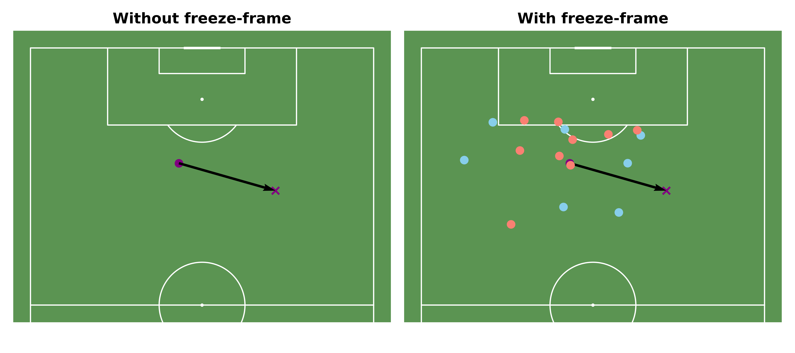{#fig-intro-event-example}



# Research Objectives

The general aim of this project is to determine to what extent the addition of spatial context features enhances and alters the standard VAEP model. This entails the following objectives:

 - Develop representations of spatial context from StatsBomb $360$ freeze-frame data using feature engineering and deep learning techniques.
 - Train and evaluate VAEP models, both with and without the inclusion of spatial context representations, using supervised classification algorithms.
 - Compare and interpret these VAEP models using appropriate performance metrics and an exploration of feature importance.

# Background

In soccer analytics, *actions* refer to a *type of event* within a match which is caused by a player (e.g. a pass), with *events* being the broader set of significant occurrences in a match (e.g. passes, but also substitutions, fouls etc.) [@decroosActionsSpeakLouder2019]. Typical performance metrics focus on action outcomes, such as goals, assists and pass completion rates. Whilst such metrics can be used to determine the value of some actions and are useful for summarising player ability, soccer analytics has developed metrics to help generalise this notion of action value. Moreover, models used to assign value to actions have been enhanced by incorporating the locations of teammates and opponents, leading to improved performance and interpretability. 

As such, this section will introduce the VAEP metric and outline how spatial context has been successfully incorporated into other action valuation metrics, motivating this project's research objectives.

## Valuing Actions by Estimating Probabilities (VAEP)

@decroosActionsSpeakLouder2019 introduce Valuing Actions by Estimating Probabilities (VAEP). VAEP values actions in terms of the probability of scoring and the probability of conceding within the next $k$ actions. @eq-vaep defines the VAEP of an action $a_{i}$ for team $x$.

$$
V(a_{i}, x) = \Delta P_{scores}(a_{i}, x) - \Delta P_{concedes}(a_{i}, x), \quad V(a_{i}, x) \in [-2,2]
$$ {#eq-vaep}

If we consider a match as a sequence of $m$ on-ball actions $[a_{1},\dots,a_{m}]$, we can view some game state $S_{i}$ which corresponds to some subset of actions $[a_{1},\dots,a_{i}]$ and determine how the last action in the game state $a_{i}$ changed the probability of team $x$ scoring and conceding within the next $k$ actions. The change in the probability of scoring (and conceding) from the previous game state $S_{i-1} = [a_{1},\dots,a_{i-1}]$ to the current game state $S_{i}$ can be determined by simply finding their difference:

$$
\begin{align}
\Delta P_{\text{scores}}(a_{i},x) &= P_{\text{scores}}(S_{i},x) - P_{\text{scores}}(S_{i-1},x) \\[20pt]
\Delta P_{\text{concede}}(a_{i},x) &= P_{\text{concede}}(S_{i},x) - P_{\text{concede}}(S_{i-1},x) 
\end{align}
$$ {#eq-vaep-score-concede-probs}

These two probabilities are estimated using two supervised classification algorithms, one which estimates scoring, and the other conceding, within the next $k$ actions. The feature sets used across these two models are identical, all that varies is the labels (scoring or conceding). The authors used a feature set which corresponds to the Soccer Player Action Description Language (SPADL) format involving $9$ features, most notably the action's start and end locations, and the type of action. The authors also add "complex features", such as the time elapsed between consecutive actions, as well as "game context features", such as the scoreline at the time of the action and the amount of time remaining. 

The authors initially compared logistic regression, a random forest, XGBoost and CatBoost, finding CatBoost to perform best across both the scoring and conceding models in terms of the Brier Score and the Area Under the Receiver Operating Characteristic Curve (AUC-ROC). The authors also extend the VAEP metric by using it to provide player ratings, where the VAEP of each action in a player's set of actions $A_{p}^{T}$ across some time frame $T$ are considered cumulatively, and normalised per-$90$ minutes played during $T$.

$$
\text{rating}(p) = \frac{90}{m}\sum_{a_{i} \in A_{p}^{T}} V(a_{i})
$$ {#eq-vaep-player-rating}

The authors compare these VAEP player ratings against traditional metrics like goals and assists per-$90$, as well as market valuations of players. The authors found the top-$10$ highest players ranked by VAEP captured players typically considered to be amongst the best in the Premier League, despite them not appearing in the top-$10$ goals + assists per-$90$ ranking. The top-$10$ VAEP ranked list also had a higher overall market valuation than the top-$10$ goals + assists per-$90$ ranked list (€$1,110$ Million vs $947 Million$), which suggests VAEP more comprehensively represents player value compared to traditional metrics.

@decroosInterpretablePrediction2020 extend their previous work by improving model interpretability. Given that the initial findings from @decroosActionsSpeakLouder2019 suggest the use of gradient boosting algorithms for VAEP model classifiers, these models are more difficult to interpret than methods such as logistic regression. As such, @decroosInterpretablePrediction2020 built a generalised additive model (GAM) on the top-$10$ most important features from the original VAEP feature set, as determined by the average *gain* (for the present classifiers, this is the reduction of Gini impurity - see @sec-gini-impurity) that feature imports on the model across all splits involving that feature. The authors found a very small drop in classifier performance: a $0.2\%$ increase in the normalised Brier score compared to XGBoost on the original VAEP feature set, and a $0.1%$ increase on the top-$10$ most important feature set. The authors argue the large gains in utility came from the added interpretability from being able to assess each univariate function which comprised their GAM model. This enables a direct observation of how each function contributes to its prediction across the domain of that function. For example, *distance to opponent goal* constituted one of the top-$10$ features, and figure $2$ in @decroosInterpretablePrediction2020 shows how the goal scoring probability changes across the domain of this feature's function. Matching intuition, a higher goal scoring probability is observed for lower distances to the opponent's goal, with this probability dropping exponentially as distance increases. This added interpretability helps to demonstrate the greater tactical understanding which soccer analysts may benefit from when using a GAM-based VAEP model, and that such interpretability may be gained without a significant loss in performance.

One potential limitation of the VAEP model is that it lacks a representation of wider spatial context from the positions of teammates and opponents during actions [@desa-freireEventDataBased2025], due to its use of event data only. Every action taken by a player exists within a spatial context which determines the options available to a player, influencing their decision making. The use of spatial context in VAEP models is also understudied, despite its addition having been successfully applied to several alternative action value metrics. 

## Related Work: Applications of Spatial Context to Action Value Metrics

### Expected Goals (xG) {#sec-xg}

Expected goals (xG) is an approach commonly used for assigning value to individual shots [@AssessingPerformancePremier; @macdonaldExpectedGoalsModel2012]. General to xG approaches is the representation of the value of some shot as the probability that it results in a goal. These goal probabilities are estimated via various classification algorithms such as logistic regression, gradient boosting and deep learning methods [@meadExpectedGoalsFootball2023]. Features used in xG models typically include *action-intrinsic* variables such as distance/angle to the centre of the opponent's goal and the body part used, along with *match-context* variables such as the current match scenario (e.g. set piece, open play) [@anzerGoalScoringProbability2021; @meadExpectedGoalsFootball2023;  @robberechtsHowDataAvailability2020].

@cefisNewXGModel2025 incorporate spatial context into the xG model by considering the number of players ahead of the shooter ($x$ co-ordinate greater than the shooter's) within a fixed radius ($y$ co-ordinate $\pm10\%$ of the shooter's). From this count, they derive two binary variables `D1.OpponentsPlayer` and `D2.OpponentsPlayer`, where the former equals $1$ when the number of players in this area is greater than $0$, and the latter equals $1$ when the number of players in the area is greater than $1$. They also consider the $x$ and $y$ co-ordinates of the opponent's goalkeeper (`GK x coordinate`, `GK y coordinate`). Table $3$ in @cefisNewXGModel2025 shows the coefficients and odds ratios of each feature in their logistic regression xG model across their $4$ different techniques for addressing class imbalance. `D1.OpponentsPlayer`, `D2.OpponentsPlayer`, and `GK x coordinate` all have negative coefficients, indicating a reduction in the log odds of the shot resulting in a goal. This is particularly pronounced for `D2.OpponentsPlayer`, with a coefficient range of $-6.13$ to $-5.69$, indicating that the probability of scoring (i.e. xG) is reduced by around $99.73\%$ (since $1 - e^{(-5.69 + -6.13)/2} \approx 0.9973$) when there is more than $1$ opposition defender within proximity of the shooter. This finding matches intuitions about the influence of the opposition's positioning on goal probability and highlights how the addition of spatial context during modelling can enhance the xG metric.

### Expected Threat (xT)

A further action value metric is expected threat (xT). xT measures the value of actions based on where on the pitch the action moves the ball from and to. @SinghIntroducingExpectedThreat2018 derived the following equation for calculating the xT of a given location on the pitch:

$$
\text{xT}_{x,y} = (s_{x,y} \times g_{x,y}) \left( m_{x,y} \times \sum_{z=1}^{Z}\sum_{w=1}^{W} T_{(x,y) \to (z,w)} \text{xT}_{z,w} \right)
$$ {#eq-xt}

If we discretise the football pitch into some $Z \times W$ (@SinghIntroducingExpectedThreat2018 uses $Z=16$ and $W=12$) set of equally-sized square zones $(x,y)$, we can consider three possible attacking options when the ball is in some zone $(x,y)$: shoot, carry or pass. $(s_{x,y} \times g_{x,y})$ quantifies the value of shooting from zone $(x,y)$ by weighting the probability of scoring $g_{x,y}$ by the probability of shooting $s_{x,y}$. The other two options, carrying or passing, involve moving the ball from $(x,y)$ to $(z,w)$. The transition matrix $T_{(x,y)}$ provides the probability of moving the ball from zone $(x,y)$ to any zone $(z,w)$ after $1$ time step. If we consider all $Z \times W$ possible options and multiply their transition probabilities by the value of its respective $(z,w)$ zone, we can take their sum and weight it by the probability of moving the ball to another zone when in $(x,y)$. This provides a quantification of passing or carrying the ball, which when multiplied by the shot-probability weighted xG of zone $(x,y)$ provides the xT of the ball being at zone $(x,y)$. However, given that @eq-xt assumes that the value of each zone $(\text{xT}_{z,w})$ is already known a-priori, we must estimate its value. The xT model thus begins by setting every zone $(x,y)$ to have an xT of $0$. This simplifies @eq-xt to essentially be the xG of zone $(x,y)$, weighted by how likely players are to shoot from that zone:

$$
\text{xT}_{x,y}^{(0)} = (s_{x,y} \times g_{x,y})
$$ {#eq-xt-first-iteration}

We can then take the xT values from this first iteration and recalculate them iteratively until convergence. @SinghIntroducingExpectedThreat2018 suggests $4$--$5$ iterations are sufficient but that this may vary across datasets. To then assign xT to an action, we simply subtract the xT of the end location of the action (i.e. the xT of zone $(z,w)$) by the xT of the start location (the xT of zone $(x,y)$). This approach is useful for allowing us to determine the value of any on-ball attacking action, not just shots. We can also quantify genuinely valuable actions at any point during a chain of actions (e.g. an incisive pass during a sequence which ends in a goal), rather than suffering from a bias towards terminating actions (goals, assists).

@everettContextualExpectedThreat2022 introduce spatial context to the xT transition matrix $T_{(x,y)}$ via a pitch control [@spearmanPhysicsBasedModelingPass2017] and interception model [@BurrielQuestForTheRightPass2021] which was used to train a convolutional neural network (CNN) to produce the transition probabilities for their contextual transition matrix $T_{(x,y)}^{\star}$. The pitch control model considers the probability of a player controlling the ball as a function of their distance from opposition players, whilst the interception model introduces an additional transition probability, that being the probability of the ball being intercepted when moving from zone $(x,y)$ to its intended destination $(z,w)$. The authors found the introduction of spatial context yielded a modest improvement in terms of model fit, reducing the log likelihood of the xT model from -5.137 to -4.151. Greater gains were found in its useful applications to tactical analysis, such as enabling the authors to apply a Basin-Hopping optimiser [@walesGlobalOptimizationBasinHopping1997] to find more optimal defensive shapes than which occurred during actions, using their derived Threat Above Expected (TAx) metric as the algorithm's loss function.

### Expected Possession Value (EPV)

Expected possession value (EPV) [@fernandezFrameworkFinegrainedEvaluation2021] is an action valuation metric, derived from other sports such as basketball [@cervoneMultiresolutionStochasticProcess2016], which exploits tracking data to assign value to a game state (e.g. during an action) at time $t$ via a consideration of all possible subsequent paths it can take.

$$
\text{EPV}_{t} = \sum_{a \in A} \mathbb{E}[G|A = a, T_{t}] \quad \mathbb{P}(A=a|T_{t})
$$ {#eq-epv}

@eq-epv shows that the EPV at time $t$ for some action is determined by the expected value of $G$ (typically a goal being scored or not) given some action $a$ has occurred in some spatiotemporal context $T_{t}$, multiplied by the probability of that action $a$ occurring in the spatiotemporal context $T_{t}$. For each action $a$ considered in the action set $A$, we sum these expected values to provide an EPV of some game state at time $t$. Thus EPV can be applied to any game state, not simply at the time at which discrete match events or actions occur.

We can see from the term $T_{t}$ that EPV relies upon spatial context to operate. The authors list several spatial features used in the EPV model, such as pitch control, number of players within $3$m of the ball location, and the number of players within the area circumscribed by the ball and the two posts of the opponent's goal. EPV is thus inherently sensitive to spatial context in its valuation of actions. The utility provided by EPV's incorporation of spatial context is explored by the authors. For example, they use EPV to determine the on-ball (passes with positive EPV) and off-ball (pitch locations with positive EPV if a pass were to arrive there) advantage Liverpool in 2014/15 had during possession when up against different opponent formations. This analysis shows both where Liverpool were successful and unsuccessful in their passing decision (on-ball) and where valuable regions of the pitch are to direct passes towards during build-up (off-ball). Such an analysis is extremely useful for tactical decision making as, in response to opposition pressing structures, teams can evaluate where on the pitch they should look to progress the ball towards to be most effective during build-up play, and to evaluate how successful their current approach is.

### Summary

To summarise, the discussed applications demonstrate the utility provided by incorporating spatial context into action valuation models. Given the lack of investigation into augmenting VAEP models with wider spatial context, this project addresses this research gap and explores what role representations of spatial context play in altering model behaviour and, potentially, performance. 

## Representing Spatial Context

### Manual Spatial Feature Engineering {#sec-manual-spatial-feature-engineering}

Previous research has represented spatial context using features engineered from spatial data. 

As described in @sec-xg, @cefisNewXGModel2025 derived two binary features `D1.OpponentsPlayer` and `D2.OpponentsPlayer` from player $x$ and $y$ co-coordinates, indicating the number of players within the immediate frontal proximity of the shooter.

@petersExpectedPassTurnovers2024 developed an Expected Pass Turnovers (xPT) metric, used to measure the probability that a given pass would result in a turnover (conceding possession to the opposition) which can be used to assess how player's passing ability during some time interval compares to what would be expected on average, given the set of passes made by that player and the contextual factors relating to those passes. The authors derive xPT values from a binary logistic mixed-effects model trained on a feature set which included two features derived from StatsBomb $360$ freeze-frames: "three pressure radii" (the number of opponents within three radii of varying, but unspecified length around the ball carrier) and number of "unmarked teammates" (teammates with no opponents within 2m of them). The authors found the addition of these "positional" features improved model AUC by 6.1 points 

@amichayCharacterizingSpatialStructures2025 measured the areas of convex hulls and inner layers to represent team shapes. A convex hull, in this context, is the area inscribed between the outer-most positioned players on the pitch for a given team. A larger area corresponds to a wider/longer team shape, whereas a smaller area is narrower/shorter. Since this convex hull only considers the outer-most players, a second convex layer can be created from the players who do not contribute to the hull. The ratio of these two areas forms the author's derived Layer Ratio (LR) metric, which summarises the compactness of the team shape.

### Spatial Embeddings: Set Transformer {#sec-spatial-embeddings-set-transformer}

An alternative way to represent spatial context is through spatial embeddings. A spatial embedding is a real-valued vector used to represent a set of geometric objects (in this case, player co-ordinates and their characteristics) in a fixed $d$-dimensional space. These embeddings can represent non-linear relationships between objects and thus may serve to represent patterns, like defensive and offensive team structures during actions.

However, as seen in @fig-player-json, StatsBomb *three-sixty* data does not identify individual players within each freeze frame (except from the actor). Thus, to create embeddings for player positions, we must use a neural network which has *permutation invariant* input layer. That is, the output of the network (i.e. the embeddings) should not depend on the order in which features appear in the input layer. This would enable the locations of players in each freeze-frame to be inputted in any order and still produce the same embedding. It would also be useful for such a network to attend to spatial relationships that may exist across freeze-frames, such as defensive shapes.

One useful technique for developing a permutation-invariant network for spatial embeddings is a *set transformer* [@leeSetTransformerFramework2019]. A set transformer is a variation on the standard transformer architecture from @vaswaniAttentionAllYou2017 which can be used to process sets such that the output of the transformer is invariant to how elements in the set are permuted when entering the model. 

Transformers use multihead self-attention layers in a traditional encoder-decoder architecture. Multihead self-attention works by projecting an input sequence $X \in \mathbf{R}^{n \times d}$ into different learned linear projections of the input embeddings: $\{Q=XW_{Q}, K=XW_{K}, V=XW_{V}\} \in \mathbb{R}^{n\times d}$. Each row corresponds to a token representation in a different learned subspace. The self-attention mechanism determines how much each token should attend to other tokens, including itself, by computing similarity between so-called *query* vectors and *key* vectors. If the similarity between a *query* and a *key* is high, the corresponding *value* vector contributes more strongly to the output representation. This is computed for all tokens simultaneously, producing pairwise interactions between all elements in the sequence, including self-interactions. The attention mechanism achieves this via scaled dot-product attention:

$$
\text{Attention}(Q,K,V) = \text{softmax}\left(\frac{QK^{\top}}{\sqrt{d_{k}}}\right)V
$$ {#eq-attention}

Multihead attention then involves performing this scaled dot-product attention in parallel $h$ times, each with their own set of $Q,K,V$ matrices. Outputs are then concatenated and fed into a standard feedforward neural network. 

The multi-head attention mechanism of standard transformers is adapted in set transformers via *induced set attention blocks* (ISABs). An ISAB performs self-attention between set elements by introducing *inducing points* which contain parameters learned during training. These inducing points are some fixed-sized vector $I$ and attend to the inputted set $X$ to produce a transformed set $H$. The input set $X$ then attends to $H$ to produce a final set of $n$ elements. This method improves computational efficiency as the size of the inducing points vector $|I|$ can be set to be smaller than the input size $|X|$, thus avoiding standard pairwise self-attention and reducing time complexity from $O(n^{2})$ to $O(nm)$ where $m < n$.

Important for the purposes of this present project, set transformers also enable permutation invariance by dropping position encodings of input set elements and pool outputs via pooling with multihead attention (PMA). PMA works similarly to multihead attention but instead pools the representations of each element of the set into $k$ vectors, each providing a representation of the whole set. $k$ is typically set to $1$, providing a single representation of the set, but $k>1$ is permitted. The queries $Q$ are a fixed set of learned *seed vectors* $S$. Reordering the set will thus result in the same pooled representation via PMA, enabling permutation invariance.

As such, the encoder component of the set transformer is used to generate spatial embeddings. However, regarding the decoder, this component is simply used during the training process. The decoder takes the encoder's generated spatial embedding as an input and attempts to reconstruct the original freeze-frame array. The deviation between the original array and the decoder's array provides a means to assess how well the encoder's generated spatial embedding represents the freeze-frame array, and thereby constitutes a measure of the set transformer's performance: its loss function. The exact loss function used in this present project is discussed in @sec-set-transformer-loss-function. Given that the role of the decoder is to provide a reconstruction objective for evaluating the quality of the encoder's learned spatial embedding, it does not necessarily require the same self-attention mechanisms used by the encoder. Such a design choice to use a lightweight, non-attention based decoder has been applied in the SegFormer architecture [@xieSegFormerSimpleEfficient2021] for regular transformers, and successfully applied to set transformers by @ashcroftModellingComplexVector2023 in their work on generating illustrations by training a generative set transformer model to represent them as "stroke clouds" (a type of set comprised of Bézier curves) whilst using a non-attention based diffusion decoder. In this present project, the encoder is responsible for modelling relationships between players and producing a fixed-dimensional representation of the freeze frame, while the decoder acts as a reconstruction head that maps this representation back to the original player freeze-frame. With the decoder playing an instrumental role in the development of spatial embeddings, it is arguably sufficient for the decoder to have a relatively simplistic architecture, provided the loss function used preserves permutation-invariance.

Applications of set transformers in soccer analytics have typically fallen in the domain of trajectory prediction. @kimBallTrajectoryInference2023 apply set transformers in the context of soccer analytics. The authors use set transformers to encode representations of player trajectories from tracking data snapshots to infer ball trajectories. @capelleraFootbotsTransformerBasedArchitecture2024 similarly developed *FootBots* using set transformer architecture to improve player and ball motion prediction over traditional models. Whilst this domain deviates from this project, these studies do highlight the appropriateness of using set transformers to encode player positions.

This project seeks to use set transformers to produced fixed-sizes spatial embeddings for each team's set of players within each freeze-frame sample. This can be achieved by first converting each individual co-ordinate pair, along with its characteristics (teammate, goalkeeper, actor), into an embedding via an initial input projection sublayer. Each set of individual co-ordinate embeddings for each team in each freeze-frame can then be passed as an input tensor to the set transformer which will produce embedding representations of each set of co-ordinates. The initial embedding of co-ordinate pairs is necessary to ensure the set transformer has enough dimensions to learn from whereas simply having $5$ dimensions (i.e. $x, y$ co-ordinates, and the $3$ player attributes) would be insufficient to capture multiple non-linear relationships. 

# Methodology

## Datasets Outline

The project uses data from StatsBomb's Open Data repository. This repository has "made certain leagues of StatsBomb Data freely available for public use for research projects and genuine interest in football analytics" [@StatsbombOpendata2026]. The StatsBomb Open Data repository provides the following datasets, and [data specification documents](https://github.com/statsbomb/open-data/tree/master/doc) exist which outline variables, data types and variable descriptions for each dataset: 

 - **competitions.json:** A single JSON file for competition summary information.
 - **events:** A directory containing a single JSON file for each match, detailing each event which takes place within that match (e.g. each pass, shot, carry etc.).
 - **lineups:** A directory containing a single JSON file for each match, providing information about each player who participated in that match (e.g. their position, shirt number, nationality).
 - **matches:** A directory containing a single JSON file for a season in a given competition, providing summary information about each match played in that season (e.g. match date, home/away teams and scores).
 - **three-sixty:** A directory containing a single JSON file for each match, providing data for each event in a given match detailing the position of each player in the broadcaster's frame at the moment of that event.

@decroosActionsSpeakLouder2019, along with VAEP, introduce the Soccer Player Action Description Language (SPADL) as a data engineering format to enable "human-interpretable, simple and complete" records of actions within football matches. A variant of this format is used in this project for the baseline feature set, that being Atomic-SPADL [@IntroducingAtomicSPADLNew2020]. Atomic-SPADL represents an action without considering its result (success vs failure), unlike SPADL which includes the result. An example of the effect this has on action representation is that a pass (one action under SPADL) is separated into two actions: the giving of the pass, and the reception of the pass. An additional "interception" action type is introduced to enable incomplete passes to be captured. Atomic-SPADL therefore introduces more precision in how actions are represented as actions are now indivisible (hence atomic). This atomic-SPADL format is then augmented in this project by the addition of engineered spatial features. 

The project uses *events* and *three-sixty* data corresponding to `{python} format(number_of_matches, ",")` matches from UEFA Men's Euro 2020 & 2024, UEFA Women's Euro 2022 & 2025, FIFA Men's World Cup 2022, FIFA Women's World Cup 2023. Unlike most competitions in this repository, *three-sixty* data is available for every match in this sample, enabling player positional context to be incorporated into feature engineering for `{python} format(number_of_events, ",")` match events.

### Limitations of Datasets

Football analysts often make use of tracking data [@goesUnlockingPotentialBig2021]. Rather than considering discrete time events, tracking data provides a continuous record of player and ball position for the duration of a match. This enables analysts to model actions in matches as continuous processes, accounting for the position and movements of the entire team, unlike with events data. Such tracking data is often proprietary and is thus not available for public use [@bassekIntegratedDatasetSpatiotemporal2025]. This limits the scope of the present project to viewing events as discrete in time, thus losing some surrounding context which may be informative (e.g. player movement direction and velocity). 

Events data is nonetheless relatively comprehensive, covering a much larger sample of matches than the limited publicly-available tracking data [@olthofPerspectivesDataAnalytics2025]. Furthermore, the use of StatsBomb's *three-sixty* data does address this limitation somewhat by providing snapshots of proximal player positions at the point of each event, allowing some inference to be made regarding team positioning during match events. However, these snapshots do not necessarily capture every player's location during an event, just those within the view of the broadcast camera [@StatsbombOpendata2026]. 

A further limitation is with the use of SPADL formatted data. Recent work by @joVERSAVerifiedEvent2026 has shown that some events data contains logical inconsistencies (i.e. sequences of events which are not logically possible), which the SPADL format does not correct for. The authors develop the Verified Event Data Format for Reliable Soccer Analytics (VERSA) to address this issue using a state-transition model to automatically identify and correct logical inconsistencies, improving performance on VAEP model training. However, their results on StatsBomb data suggest that the atomic-SPADL format still slightly outperforms VERSA. This result, along with the increased precision in action representation mentioned earlier, motivates the use of the atomic-SPADL format in this project, but it is recognised that the potential data integrity issues highlighted by this paper will not be explicitly handled as implementing VERSA is non-trivial and thus beyond the scope of this project. 

## Data Collection

Data was obtained from the StatsBomb Open Data Repository via the `statsbombpy` [@StatsbombStatsbombpy2026], `socceraction` [@QuickstartSocceraction153, @decroosActionsSpeakLouder2019], and requests [@RequestsPythonHTTP] libraries. The `statsbombpy` and `socceractions` libraries were used to collect raw events data from the matches in each competition, whilst `requests` was used to collect $360$ freeze-frames from the StatsBomb Open Data Repository directly. Events data was then merged with freeze-frame data and each competition's data was saved to an individual parquet file.

## Data Preprocessing

With StatsBomb events and *three-sixty* data collected, the first preprocessing step requires converting these events into SPADL-formatted actions. This was achieved by passing each match's set of events to the `convert_to_actions` function from `socceraction`. This also required the rejoining of freeze frame data, since this preprocessing function only returns SPADL formatted data, not custom features.

To then convert these actions to the atomic-SPADL format, the `convert_to_atomic` function similarly takes each match's set of actions and returns them in atomic-SPADL format. The atomic actions of each match from each competition are then saved to parquet files, one for each competition.

With the derived atomic-SPADL actions, spatial context features are subsequently added during data engineering by joining on the original `event_uuid`, which actions share a many-to-one relationship with.

## Data Engineering

### Manually-Engineered Spatial Context Features

\

::: {#fig-player-json}
```json
{
    "teammate": boolean,
    "actor": boolean,
    "keeper": boolean,
    "location": [float, float]
}
```
StatsBomb $360$ freeze-frame JSON schema
:::

\

@fig-player-json outlines the JSON schema for StatsBomb $360$ freeze-frames. Each freeze-frame JSON object has an associated `event_uuid` to enable joins with events data, and a `visible_area` polygon which indicates the viewing area from the broadcast camera at the moment the action took place. We can see from the available data, that it is possible to construct the opposition proximity metric from @cefisNewXGModel2025 and a partial convex hull area or LR as explored by Amichay et al. (2025). Given that the sample in this project applies to on-ball actions, not just shots, the opposition proximity metric from @cefisNewXGModel2025 is adapted to consider a $\ang{360}$ radius around the player, rather than a frontal semi-circle. 

Thus, for this project, the following spatial features were engineered for teammates and opponents, respectively, using *three-sixty* data. These are both inspired by the literature and chosen by myself:

 - Euclidean distance to nearest teammate (meters)
 - Euclidean distance to nearest opponent (meters)
 - Number of teammates within $5$ meters of the actor
 - Number of opponents within $5$ meters of the actor
 - Average Euclidean distance to teammates in freeze-frame (meters)
 - Standard deviation of Euclidean distance to teammates in freeze-frame (meters)
 - Average Euclidean distance to opponents in freeze-frame (meters)
 - Standard deviation of Euclidean distance to opponents in freeze-frame (meters)
 - Teammate convex hull area (based on players within freeze-frame) ($m^{2}$)
 - Opponent convex hull area (based on players within freeze-frame) ($m^{2}$)

To outline the rationale here, opponent spatial metrics are intended to provide a proxy measure of *pressure* applied to the actor and *defensive shape*, which imposes limitations upon where the ball can be progressed to by introducing a risk of losing possession. Teammate spatial metrics provide a proxy measure of *pass availability* for the actor and *rest defense* - the positional structure of a team whilst in possession to prepare for potential counterattacks [@WhatRestDefence].

For *number of teammates/opponents within 5 meters of the actor*, whilst a radius of $5$ meters somewhat arbitrary, @bischofbergerBlameEasierPraise2026 argue that a "lower radius might risk missing actual pressure and involvement while a higher radius might lead to a weaker attribution between players and stronger intra-team correlations" p.5. @calabuigMathematicalModelStudy2024 also use a $5$ meter radius around players as part of their construction of *influence areas* - the amount of overlap of two player's circles equates to how much influence the defender has over the attacker, providing a measure of defensive pressure. 

It should be noted that such an approach to approximating opposition pressure or teammate pass availability is considered relatively simplistic, with more sophisticated approaches such as pitch control [@fernandezWideOpenSpaces2018] being preferred in the literature. However, given that metrics like pitch control require tracking data to be implemented correctly, they fall beyond this project's scope. Regardless, the intention with these manually-engineered spatial context features is to provide an approximation of spatial context, which is easy to implement, to contrast it with the generated spatial context embeddings in terms of classifier performance and behaviour. Given that such a measure has been successfully and usefully incorporated in previous literature, it was deemed appropriate for this present project.

### Spatial Context Embeddings

To generate an $n$-dimensional embedding of each freeze-frame for each action, we can begin by converting each JSON object in each freeze-frame to a $1 \times 5$ array, using the $5$ available features as shown in @fig-player-json (the location key can be split into an $x$ co-ordinate feature and a $y$ co-ordinate feature, respectively). Each freeze-frame consists of $n$ players, and so $n$ arrays are stacked into an $n \times 5$ array. 

This $n \times 5$ array, constituting each player within a single freeze-frame, is then be projected into a higher dimensional space via an initial learned affine transformation $h_{i}$. 

$$
h_{i} = W_{e}x_{i}+b_{e}, \quad x_{i} \in \mathbb{R}^{5},\, h_{i} \in \mathbb{R}^{d_{\text{hidden}}}
$$ {#eq-affine-transformation}

The dimensionality $d_{\text{hidden}}$ of this learned projection layer is left as a tuneable hyperparameter during optimisation, with $d_{\text{hidden}} \in \{32,64,128,256\}$ being the candidates used. This transformation provides the set transformer with a higher-dimensional latent representation of each element, enabling it to learn richer relationships between players within each freeze-frame than would be possible from the raw feature representation alone.

This projection layer $H \in \mathbb{R}^{n \times d_{\text{hidden}}}$ is then inputted to the set transformer encoder, whereby the self-attention mechanism learns the weight matrices $W_{Q}, W_{K}, W_{V}$ which minimise loss (see @sec-set-transformer-loss-function). 

#### Set Transformer Loss Function {#sec-set-transformer-loss-function}

Given that the freeze-frames - particularly the player co-ordinates - constitute permutation-invariant sets, the loss function used must also respect this characteristic. Each player in each freeze-frame consists of two broad components: a pair of $x, y$ co-ordinates for their location on the pitch and a set of attributes about that player (teammate, goalkeeper, actor). 

For the location component, we require a loss function which preserves the permutation-invariant property of our freeze-frames, which are unordered sets. Chamfer distance [@barrowParametricCorrespondenceChamfer1977] fulfils such requirements. 

Chamfer distance conducts a nearest neighbour search between points in one set with points in the other set. Each point is assigned its nearest neighbour in the other set and the distance is taken between them. Each of these distances are summed and averaged across the number of elements from the first set. Minimisation of Chamfer distance is achieved by successfully reconstructing the original set. In this scenario, this would correspond to the decoder successfully reconstructing the co-ordinate locations of each player within the original freeze-frame. This nearest neighbour search can be conducted with quadratic time complexity, as we must compute every pairwise distance between original and reconstructed set elements.

$$
\mathcal{L}_{\text{Chamfer}} = d_{\text{CH}}(S, \hat{S}) = \frac{1}{|S|}\sum_{x\in S}\min_{\hat{x} \in \hat{S}}||x-\hat{x}||^{2}_{2} + \frac{1}{|\hat{S}|}\sum_{\hat{x} \in \hat{S}}\min_{x \in S}||\hat{x} - x||^{2}_{2}
$$ {#eq-chamfer-distance}

Alternative distance measures may be used in place of Chamfer distance, such as the Hungarian method [@kuhnHungarianMethodAssignment1955], which can be used to find an optimal solution to the assignment problem: finding the permutation of the reconstructed set which, when paired one-to-one with the original set, minimises loss. Chamfer loss does not enforce such a one-to-one correspondence, as elements from the original set may share the same nearest neighbour from the reconstructed set (and vice versa).

Rather than searching through each permutation naively, which would result in a factorial search time complexity, the Hungarian method constructs a cost matrix which records the pairwise distances of each point in the original set with each point in the reconstructed set. 

To find the optimal permutation, the minimum value of each row is subtracted from its elements. Then, the minimum value of each column is subtracted from each of its elements. If each row in the resulting matrix has an element equal to $0$ where the column ($j$-index) of that element is not reused in the $0$-valued elements of any other row, then an optimal assignment can be derived. 

If this is not the case, we find the number of horizontal and vertical lines needed to cover each $0$ element (a *covered value*) in the matrix. If less than $n$ lines were used, where $n$ is the number of rows and columns in the cost matrix, then we subtract the minimum positive-valued row value from each row element which is *uncovered* (i.e. non-zero) and add the value to elements which are covered. We then reassess whether $n$ lines are needed to cover the $0$ values and repeat until this condition is met. The resulting matrix elements with values equal to $0$ correspond to the optimal one-to-one pairing of elements in the original set with elements in the reconstructed set. This approach to the Hungarian method has a cubic time complexity, resulting in a substantial improvement over the naive method.

Despite the Hungarian method having the advantage of preserving a one-to-one correspondence between original and reconstructed set elements, Chamfer loss was deemed preferable for this project as:

 - Reconstructed freeze-frames are used as a training signal to produce encoder-generated embeddings which capture meaningful spatial context information. The decoder-generated freeze-frames are not needed for any downstream tasks (e.g. synthetically generating realistic football player event freeze-frames).
 - Players in freeze-frames are not uniquely identifiable, so enforcing one-to-one correspondence does not necessarily provide additional semantic information.
 - Chamfer loss operates with $O(n^{2})$, whereas Hungarian matching is $O(n^{3})$. For a training set size $n \in [10^{5}, 10^{6}]$, such as in this project, and given that the constant factor of Chamfer distance is comparatively computationally cheaper than that of the Hungarian method, the reduction of time complexity by a factor of $n$ makes using Chamfer loss more economical.

Future work with developing spatial embeddings from freeze-frames may wish to empirically contrast alternative reconstruction loss functions whilst considering the trade-off in terms of computation time.

The second component of this set transformer's loss function relates to the teammate, actor and goalkeeper flags which each player in each freeze-frame as, as seen in @fig-player-json. Given that the teammate, actor and goalkeeper statuses of each player are binary categorical variables, we can model their realisations as being sampled from Bernoulli distributions. The decoder can therefore predict a probability of the flag being equal to $1$ and we can use this prediction to evaluate performance. 

$$
\mathcal{L}_{\text{BCE}}=\frac{1}{N}\sum_{i=1}^{N}\left(-y_{i}\log \hat{p_{i}}-(1-y_{i})\log(1-\hat{p_{i}})\right)
$$ {#eq-bce-loss}


Binary cross entropy (BCE) loss provides a measure of how close predicted probabilities are to the true binary values. When the true value is $1$, the second term evaluates to $0$ and thus the loss is determined by the first term $-y_{i}\log \hat{p_{i}}$, which evaluates to $0$ when the predicted probability is $1$, and approaches $\infty$ when the limit of the predicted probability tends to $0$. When the true value is $0$, the first term cancels and the second term similarly provides a measure of loss which is $0$ when the predicted probability is $0$, and approaches $\infty$ when the loss approaches $1$. This loss is calculated for each data instance individually and its average is taken to provide an overall measure of BCE loss.

To combine these two measures into a single loss function for the set transformer, we can use a weighted sum, where the weights $\lambda_{xy}$ and $\lambda_{f}$ are tuneable hyperparameters. @eq-set-transformer-loss-function therefore constitutes the loss function used for this present project's set transformer.

$$
\mathcal{L} = \lambda_{xy} \mathcal{L}_{\text{Chamfer}} + \lambda_{f}\mathcal{L}_{\text{BCE}}
$$ {#eq-set-transformer-loss-function}

## Set Transformer Hyperparameter Tuning

Rather than training a single set transformer with arbitrary hyperparameters, it would be preferable to use an algorithm to choose values for the model's hyperparameters as to minimise its loss function, whilst avoiding overfitting. This process is known as hyperparameter optimisation or tuning.

One standard approach to hyperparameter tuning is grid search. With grid search, a discrete set of candidate values are provided for each model hyperparameter, and each possible combination of these candidates is trialled. Grid search, whilst exhaustive of the search space, is an inefficient means of hyperparameter tuning, relative to alternative methods. With $h$ hyperparameters in the model, and $v$ candidate values across all hyperparameters, the search space with grid search is equivalent to $v^{h}$, which constitutes an exponential time complexity $O(v^{h})$. Grid search's efficacy is further compounded by the fact that much time is spent exploring hyperparameter value combinations which yield poor performance, relative to the optimal combination available. Moreover, the search space provided must be discrete, which potentially misses more optimal hyperparameter values that may be found in a continuous search space. Whilst potentially useful for small models where there exists well-established prior expectations for appropriate hyperparameter values, alternative methods may be preferred.

An alternative approach can be found in random search. Random search draws $n$ random samples of hyperparameter value combinations from the set of values provided and trials them. Rather than an exhaustive search of a discrete set of hyperparameter value combinations, random search enables sampling over both discrete sets of values and continuous sampling distributions for hyperparameter values. Compared to grid search, this helps to reduce the time complexity of the search space to linear time, with search time simply being a linear function of the number of desired trials - $O(n)$ - whilst also allowing for more optimal values to be chosen via the use of hyperparameter value sampling distributions. @bergstraRandomSearchHyperparameter2012 argue that since hyperparameters for a given model often do not contribute evenly to the performance of the model (e.g. the learning rate may be more important that the dropout rate), grid search wastes time exploring hyperparameter value combinations which will not yield significant gains in performance. Instead, random search randomly samples values for all hyperparameters at each trial, meaning that the most important hyperparameters are always being tested with new unique values within a fixed computational budget. Grid search instead wastes computational budget on varying less important hyperparameters whilst keeping important hyperparameters constant, since it must exhaust all possible combinations. Random search therefore can explore the search space of important hyperparameters more efficiently, providing opportunity for random search to outperform grid search. 

Despite this advantage over grid search, a limitation common to both grid search and random search is the fact that neither approach uses information gained from previous trials to improve the estimations made by future trials. Sampling efficiency could be drastically improved if an algorithm were to consider previous trials in its sampling of new candidate values. 

One family of optimiser approaches which we can use to enhance hyperparameter sampling efficiency are Bayesian optimisers. In general, a Bayesian optimiser constructs a surrogate model to predict model performance $y$ given a set of hyperparameter values $x$. This surrogate model $p(y|x)$ produces its estimates based on some prior history of trials. After each trial, the predictions from this surrogate model are used to inform an acquisition function, which explores the search space to find regions which balance currently acquired knowledge on which hyperparameters lead to improved performance over less explored regions where uncertainty is higher and thus potential for further optimisation may exist. This acquisition function then samples hyperparameter values based on this trade-off, which in turn updates the surrogate model and thus the process continues for some $n$ number of trials. A Bayesian optimiser can therefore incorporate prior evidence acquired from previous trials to inform decisions on which hyperparameter values ought to be trialled next, enabling convergence towards a local optimum. 

The present project will use a type of Bayesian optimiser known as a Tree-Structured Parzen Estimator (TPE), which is outlined in the next subsection (@sec-tpe). This TPE is implemented via the Optuna Python library [@akibaOptunaNextgenerationHyperparameter2019]. @tbl-hyperparameter-description provides an outline of the hyperparameters to be used for the set transformer in this project.

\

```{python}
#| echo: false
#| label: tbl-hyperparameter-description
#| tbl-cap: "Set Transformer Hyperparameter Descriptions"
#| tbl-cap-location: bottom
#| tbl-pos: H

df = pd.DataFrame({
    "Hyperparameter": [
        "Batch Size",
        "Dropout",
        "Embedding Dimensions",
        "Flag Weight",
        "Hidden Dimensions",
        "Learning Rate",
        "Number of Heads",
        "Number of Hidden Layers",
        "Weight Decay",
        "XY Weight"
    ],
    "Description": [
        "The number of data instances processed before model parameters are updated.",
        "A random proportion of network activations set to zero during training.",
        "The number of dimensions in the output layer of the set transformer encoder.",
        "A weighting applied to the Chamfer distance component of the set transformer loss function.",
        "The number of dimensions of each hidden layer.",
        "A weighting applied to the derivative of the loss function with respect to model parameters to control the magnitude by which parameters are updated during training.",
        "The number of self-attention mechanisms which operate in parallel in each hidden layer.",
        "The number of hidden layers used within the set transformer encoder.",
        "An L2 regularisation applied to model weights.",
        "A weighting applied to the binary cross-entropy component the set transformer loss function.",
    ]
})

(
    df.style
    .hide(axis="index")
)
```

\

### Tree-Structured Parzen Estimatior (TPE) {#sec-tpe}

A TPE is a type of Bayesian optimiser which deviates from the general approach in a few key ways. Firstly, a TPE models the probability distribution of hyperparameter values, given model performance $p(x|y)$ - an inversion of the standard Bayesian optimiser approach. Thus, a TPE seeks to update the probability distributions of each hyperparameter in line with the prior evidence accumulated about which values lead to improved performance. $p(x|y)$ is defined by two derived densities: $l(x)$ and $g(x)$. Given a set of trials with candidate hyperparameters $x$ and observed loss values $y$, a parameter $\gamma$ is defined so as to derived the $\gamma^{th}$ quantile of $y$ referred to as $y^{*}$ such that $p(y < y^{*}) = \gamma$. The exact value of $\gamma$ may be a fixed value (i.e. always use $\gamma = 0.15$), or as in the case with Optuna's default implementation, an adaptive gamma function:

$$
\gamma(n) = \min\left(\lceil0.1 n\rceil, 25\right)
$$ {#eq-adaptive-gamma-function}

This threshold $y^{*}$ is used to define two probability density estimates for the set of hyperparameters. $l(x)$ constitutes probabilities density estimates for hyperparameter values where the observed loss is less than $y^{*}$, and $g(x)$ constitutes the probability density estimates for hyperparameters values where the observed loss is greater than or equal to $y^{*}$. As such, using the definition provided by @bergstraAlgorithmsHyperParameterOptimization2011 on p.4:

$$
p(x|y) = \begin{cases}
l(x) &\quad \text{if }y < y^{*} \\
g(x) &\quad \text{if }y \ge y^{*} 
\end{cases}
$$ {#eq-tpe-model}

To then choose an optimal set of hyperparameters for the next trial, TPE aims to sample hyperparameter values which maximise Expected Improvement (EI). EI therefore constitutes the acquisition function of the TPE algorithm. EI is given as the expectation of the improvement given the surrogate model's distribution, which we can define using Bayes' rule:

$$
EI(x) = \int_{-\infty}^{y^{*}}(y^{*}-y)p(y|x)\,dy = \int_{-\infty}^{y^{*}}(y^{*}-y)\frac{p(x|y)p(y)}{p(x)}\,dy
$$ {#eq-expected-improvement}

Rather than computing this expectation directly, @bergstraAlgorithmsHyperParameterOptimization2011 instead point out since any hyperparameter combination must come from either $l(x)$ or $g(x)$, we can express $p(x)$ as:

$$
p(x) = \gamma l(x) + (1-\gamma) g(x)
$$ {#eq-prob-of-x}

We can see from @eq-expected-improvement that $EI(x) \propto \frac{1}{p(x)}$. Therefore, by substitution and then rearrangement:

$$
EI(x) \propto \frac{1}{\gamma l(x) + (1-\gamma) g(x)} = \left(\gamma + (1-\gamma) \frac{g(x)}{l(x)}\right)^{-1}
$$ {#eq-expected-improvement-propotional-to}

We can therefore see that $EI(x)$ is maximised when $\frac{g(x)}{l(x)}$ is smallest, or conversely when $\frac{l(x)}{g(x)}$ is maximised. This latter ratio is used by the acquisition function. The function samples $m$ sets of hyperparameter values from $l(x)$ and computes $\frac{l(x)}{g(x)}$. The sample with the largest value for $\frac{l(x)}{g(x)}$ is then chosen as the next candidate hyperparameter value set. This then updates the surrogate model and the process continues for $n$ trials. To provide densities $l(x)$ and $g(x)$ to the acquisition function, an initial startup period of trials is required. By default, Optuna's TPE sampler uses $10$ startup trials before performing the TPE algorithm for some $n$ number of trials.

To estimate $l(x)$ and $g(x)$, TPE uses kernel density estimation (KDE - a.k.a. the Parzen-Rossenblatt window method) [@rosenblattRemarksNonparametricEstimates1956; @parzenEstimationProbabilityDensity1962]. KDE is a non-parametric method of estimating a probability density function given some set of $n$ observations $\{x_{1},\dots,x_{n}\}$. In the case of TPE, these observations are the candidate hyperparameters from previous trials.

### Hyperband Pruning

Each set of candidate hyperparameter values is trained across some number of epochs as specified during training. However, it is possible to evaluate trials more efficiently than to simply let each of then run their full course of epochs. In the context of this project, the number of epochs per trial is the *resource budget*. Hyperband pruning [@liHyperbandNovelBanditBased2018] is a means to efficiently allocate this resource budget across trials as to avoid wasting training epochs on trials which are clearly performing poorly. 

Firstly, hyperband tuning involves three key parameters: $R_{\min}$, $R_{\max}$ and $\eta$. $R_{\min}$ is the minimum resource to be used per trial. As mentioned, for this project this is the minimum number of epochs each trial will train with. $R_{\max}$ is the resource budget we are choosing to employ (i.e. the maximum number of epochs per trial). $\eta$ is known as the reduction factor. 

Hyperband tuning uses the successive halving algorithm to assess the performance of a trial during its progress. Whilst the standard successive halving algorithm involves running trials in parallel, the implementation in Optuna involves running trial in succession and thus an alternative method is employed. For each trial, we evaluate performance after the first rung is completed (i.e. $R_{\min}$) and compare it to the performance of previous trials at that same rung. If performance is competitive with previous trials, we continue to the next rung, which is the current rung multiplied by the reduction factor $\eta$. We continue until either performance fails to compete, in which case the trial is terminated (i.e. *pruned*), or we reach the resource budget $R_{\max}$. 

What separates hyperband tuning from standard successive halving is that different sets of rungs are employed for some trials (known as brackets). Some brackets may involve starting with a smaller amount of resource, corresponding to more exploratory behaviour, whilst others may adopt a greater amount of resource initially, corresponding to a more exploitative approach. Trials are only compared to previous trials of the same bracket. This approach allows hyperband tuning to benefit from a balance of both exploratory or exploitative approaches, whereas standard successive halving must commit to one or the other. The number of brackets $s_{\max}$ used during tuning is determined as follows:

$$
s_{\max} = \left\lfloor\log_{\eta}\left(\frac{R_{\max}}{R_{\min}}\right)\right\rfloor
$$ {#eq-hyperband-pruning-brackets}

## Classifier Training

@decroosActionsSpeakLouder2019 use $4$ different supervised classification techniques to estimate scoring and conceding probabilities, enabling VAEP calculations. This project will replicate the implementation of these same $4$ techniques as closely as possible, albeit they do not provide comprehensive details on the Python version used, library versions, or all model hyperparameters.

Given that VAEP requires two concurrent classifiers to be trained for scoring and conceding probability estimates, respectively, and the introduction of manually engineered spatial features and spatial embeddings will result in a total of $32$ individual classifier models being trained, enabling the construction of: baseline VAEP; baseline + manual features; baseline + embeddings; and baseline + manual features + embeddings models. This ablation design allows for the impact of adding spatial context on model performance and behaviour to be investigated.

### Logistic Regression

Logistic regression [@coxRegressionAnalysisBinary1958] is a classification technique which estimates the probability that a given data instance belongs to some reference class (i.e. an action results in a goal scored/conceded vs no goal scored/conceded, within $k$ events). Logistic regression learns a vector of weights $\mathbf{w}$ and bias $b$ which minimises cross-entropy loss and produces a probability estimate for the data instance belonging to the reference class:

$$
P(Y = 1 | X) = \frac{1}{1+e^{\displaystyle-(\mathbf{w}^{\top}\mathbf{x} + b)}}
$$ {#eq-log-reg-model}

@decroosActionsSpeakLouder2019 report the use of L2 Regularisation and a Limited-memory BFGS, which is replicated in this project.

L2 regularisation introduces an additional penalty term to the loss function (in this case cross-entropy loss, see @sec-loss-function-cross-entropy-loss). This penalty term is some multiple $\lambda \in \mathbb{R}^{+}$ of the sum of squared weights:

$$
\text{L2} = \lambda \sum_{i=1}^{N}w_{i}^{2}
$$ {#eq-l2}

`scikit-learn` uses a hyperparameter $C = \frac{1}{\lambda}$ to control regularisation strength, which is set to $1$ by default. Since the authors do not specify otherwise, this default will be maintained for training.

Limited-memory BFGS [@liuLimitedMemoryBFGS1989] is a computationally-efficient optimisation method, used in logistic regression to iteratively minimise the loss function during training. Again, this hyperparameter is the default for `scikit-learn`.

### Random Forest

Classification tasks may also be performed by decision trees. We can treat a classification task as a form of recursive partitioning of the dataset until we obtain maximally *pure* partitions primarily consisting of data instances from a single classification class. Choosing a feature and subsequent splitting threshold which minimises impurity (see @sec-gini-impurity) until a maximum tree depth or minimum leaf node size is reached builds a decision tree which can be used to make classifications by applying a sequence of logical filters.

A random forest [@breimanRandomForests2001] is an ensemble method which aggregates results from multiple decision trees, each trained on a random subset of the training set. In a classification task, this aggregation is employed by majority voting. For each data instance, the class predictions made by each tree in the forest are counted and the class with the most "votes" is outputted as the predicted class for that instance. By having class predictions be made via majority voting from multiple decision trees, a random forest benefits from being less prone to overfitting and more robust to outliers in the dataset. 

@decroosActionsSpeakLouder2019 indicate that they used $100$ trees and $40$ parallel threads to train their random forest models. Thus, this project also used $100$ trees. However, the number of parallel threads simply determines the number of concurrent processes used, which does not impact model behaviour other than via its runtime. Since my hardware is different to the authors', this hyperparameter will be chosen during training.

### Gradient Boosting

Gradient boosting [@friedmanGreedyFunctionApproximation2001] is another ensemble method involving decision trees. Gradient boosting methods construct a "strong" predictor by sequentially adding "weak" learners, where each new learner is trained to correct the errors of the previous ensemble.

$$
\hat{y}_{i} = \sum_{t=1}^{T}\eta f_{t}(x_{i}), \quad f_{t} \in \mathcal{F}
$$ {#eq-grad-boost-model}

Each function $f_{t}$ is learned sequentially to minimise a loss function (like cross-entropy loss). At each iteration, the new weak learner is fit to the negative gradient of the loss with respect to the current model predictions. The learning rate $\eta$ is used to determine how much the next tree contributes to model estimates.

#### XGBoost

XGBoost [@chenXGBoostScalableTree2016] builds upon standard gradient boosting by incorporating regularisation and introducing improved computational efficiency, even being capable of handling sparse data (i.e. data instances which are empty in some subset of features). @decroosActionsSpeakLouder2019 use $100$ trees which are allowed to reach a maximum depth of $3$ nodes. The learning rate $\eta$ is equal to $0.1$. Again, $40$ parallel threads are used. Each of these hyperparameters (except the parallel threads) will be held constant in this project.

#### CatBoost

CatBoost [@prokhorenkovaCatBoostUnbiasedBoosting2019] is a gradient boosting method which is optimised for processing categorical predictors without requiring manual one-hot encoding. @decroosActionsSpeakLouder2019 retain the default hyperparameters for CatBoost [@CatBoostClassifier], and again use $40$ parallel threads. 

### Loss Function: Cross-Entropy Loss {#sec-loss-function-cross-entropy-loss}

Logistic regression, XGBoost and CatBoost each minimise cross-entropy loss in their classification predictions, according to their default implementations in their Python libraries. Cross-entropy measures how "surprised" the model is by observations drawn from the true data-generating distribution $p(x)$, when evaluated under the predicted distribution $q(x)$. If the model tends to assign low probability to data instances which are probable under $p(x)$, then cross-entropy will be high. A low cross-entropy is found when $q(x)$ approximates $p(x)$ well.

$$
H(p,q)=-\sum_{x \in X}p(x)\log q(x)
$$ {#eq-log-loss}

### Split Criterion: Gini impurity {#sec-gini-impurity}

Whilst the split criterion used for the random forest models is not specified, the authors do indicate that they "used the implementation from the `scikit-learn` Python package" [@decroosActionsSpeakLouder2019, p. 1860]. It is thus inferred that they use the default split criterion of Gini impurity [see @RandomForestClassifier; @pedregosaScikitlearnMachineLearning2011].

Gini impurity indicates the probability of assigning an incorrect label to a randomly chosen data instance by simply using the relative frequence of each label's occurrence in the data. 

$$
G_{m}=1-\sum_{k=1}^{K}\left(\frac{n_{m_{k}}}{n_{m}}\right)^{2}
$$ {#eq-gini-impurity}

Decision trees within random forest classifiers, at each splitting decision, choose the feature and value threshold $s$ which minimises the sum of the weighted Gini impurities of each partition $m$:

$$
G_{\displaystyle m_{\displaystyle <s}/\displaystyle m_{\displaystyle >s}} = \frac{n_{\displaystyle m_{\displaystyle <s}}}{n_{m}}G_{\displaystyle m_{\displaystyle <s}} + \frac{n_{\displaystyle m_{\displaystyle >s}}}{n_{m}}G_{\displaystyle m_{\displaystyle >s}}
$$ {#eq-gini-split}

This results in the *purest* possible split and thus corresponds to the most discriminative splitting decision available. This process then iterates on each node in the decision tree until leaf nodes are reached which each only contain a single class (in this case, $0$ or $1$). Data instances can then be classified according to this derived decision tree.

## Model Evaluation Metrics

### Area Under the Receiver Operating Characteristic Curve (AUC-ROC)

A receiver operating characteristic curve (ROC) is produced by plotting the true-positive rate (TPR) against the false positive rate (FPR) for each probability threshold a model could use to classify a data instance into the reference class (i.e. the action results in a goal scored/conceded within $k$ events). The result is an estimate of the probability that, given a random pair of instances where one is labelled $1$ and the other labelled $0$, the instance labelled $1$ is assigned by the classifier a higher probability of belonging to the $1$ class than the instance labelled $0$. A higher AUC score therefore indicates strong performance by the classifier.

$$
\text{AUC} = \frac{1}{mn}\sum_{j=1}^{n}\sum_{i=1}^{m}\phi(x_{i}, y_{i})\quad \text{where } \phi(x_{i},y_{j})=\begin{cases}1 & x_{i}>y_{j} \\ 0.5 & x_{i} = y_{j} \\ 0 & x_{i} < y_{j}\end{cases}
$$ {#eq-auc}

### Brier Score

@decroosActionsSpeakLouder2019 use the Brier score [@brierVERIFICATIONFORECASTSEXPRESSED1950] to measure the performance of the VAEP classifier models by comparing the model's predicted probability of a data instance belonging to a class with its true class membership.

$$
\text{BS} = \frac{1}{N}\sum_{i=1}^{N}\sum_{k=1}^{K}(p_{ik}-y_{ik})^{2}
$$ {#eq-brier-multi}

This is effectively equivalent to the mean squared error, where predictions equate to probabilities of belonging to the $k^{th}$ class and the true values are a one-hot encoding of that data instance's membership of that $k^{th}$ class. For binary classification this simplifies to:

$$
\text{BS}_{\text{binary}} = \frac{1}{N}\sum_{i=1}^{N}(p_{i}-y_{i})^{2}
$$ {#eq-brier-binary}

A lower Brier score indicates that the model's predicted probabilities are, on average, closer to the true outcomes.

### Cross-Entropy Loss

Cross-entropy loss was introduced as a loss function in @sec-loss-function-cross-entropy-loss, but it may also be used as a classification model evaluation metric. This project intends to use cross-entropy loss to evaluate each of the two classifier models which constitute each VAEP model. 

### Expected Calibration Error (ECE)

Expected calibration error (ECE) [@naeiniObtainingWellCalibrated2015] is a performance metric used to evaluate the ability of a classification model to make accurate predictions. ECE creates $m$ bins between $0$ and $1$ and assigns predictions to bins based on their probability estimates. For each bin, we take the accuracy of predictions in that bin $o_{i}$ and subtract from it the average of the probability estimates in that bin $e_{i}$. This is weighted by the proportion of predictions in that bin. Each bin's score is the summed to provide the ECE of the model's predictions. A lower ECE is more desirable, indicating that model predictions are close to true frequencies.

$$
\text{ECE} = \sum_{i=1}^{K} P(i) \cdot |o_{i} - e_{i}|
$$

## AUC Difference Significance Testing

To establish whether the observed differences in AUC scores are *surprising*, under the assumption that there are no significant differences in AUC scores between classifiers, we can employ the DeLong test [@delongComparingAreasTwo1988] on each pairwise comparison of features sets within the same classifier type and technique. 

The DeLong test is a non-parametric significance test used to compare the AUCs of two ROC curves which are correlated, due to being evaluated on the same set of test labels. The test estimates the covariance matrix $S$ between the two ROC curves being compared.

$$
S = \begin{bmatrix}\text{Var}\left(\widehat{AUC_{1}}\right) & \text{Cov}\left(\widehat{\text{AUC}_{1}},\, \widehat{\text{AUC}_{2}}\right) \\ \text{Cov}\left(\widehat{\text{AUC}_{1}},\, \widehat{\text{AUC}_{2}}\right) & \text{Var}\left(\widehat{AUC_{2}}\right)\end{bmatrix}
$$ {#eq-auc-covariance-matrix}

$S$ can then be used to derive the variance on the difference between the two AUC scores.

$$
\text{Var}\left(\widehat{\text{AUC}_{1}} - \widehat{\text{AUC}_{2}}\right) = \text{Var}\left(\widehat{\text{AUC}_{1}}\right) + \text{Var}\left(\widehat{\text{AUC}_{2}}\right) - 2\left(\text{Cov}\left(\widehat{\text{AUC}_{1}},\, \widehat{\text{AUC}_{2}}\right)\right)
$$ {#eq-var-of-auc-diff}

Taking the observed difference $\Delta = \widehat{\text{AUC}_{1}} - \widehat{\text{AUC}_{2}}$ and dividing by the standard error of this difference provides a $z$ statistic for $Delta$:

$$
z = \frac{\Delta}{\sqrt{\text{Var}(\Delta)}}
$$

Under the null hypothesis that the true population AUC scores are equal $H_{0}:\text{AUC}_{1} = \text{AUC}_{2}$, we can calculate the $p$-value of this observed $z$ statistic. Provided that $p$ is less than or equal to a pre-specified significance threshold $\alpha$, we can conclude that our estimate provides sufficient evidence to reject $H_{0}$. These significance tests will employ a standard significance threshold of $0.05$.

An important caveat here is that given we are employing $6$ pairwise comparisons within each classifier type and technique, the family-wise error rate of these $6$ comparisons will exceed $\alpha$. This is because each individual significance test has a $5\%$ chance of producing a false positive (concluding a significant difference when there isn't one). The probability of obtaining at least $1$ false positive within a family of $m$ significance tests is:

$$
\text{FWER} = 1 - (1-\alpha)^{m}
$$ {#eq-family-wise-error-rate-one-false-positive}

This equates to a probability of obtaining a single false positive within a single family of pairwise AUC comparisons. The Holm-Bonferroni method [@holmSimpleSequentiallyRejective1979] can be used to provide corrected $p$-values considering their $\text{FWER}$. 

This method first sorts each computed $p$-value for the $m$ significance tests in ascending order and adjusts the significance threshold using the ratio $\frac{\alpha}{m + 1 - k}$, where $k$ is the index (starting at $1$) of each $p$-value in the sorted list. The first $p$-value is therefore testing if $p \le \frac{\alpha}{m + 1 - 1}$. If this is true, we move to the next $p$-value in the list and increment $k$. This continues until either the condition is not met, in which case the remaining significance tests are deemed non-significant, or all $m$ tests have been corrected.

The implementation of significance threshold adjustment in the `statsmodels` package involves adjusting the computed $p$-values themselves, rather than adjusting the significance threshold [@wrightAdjustedPValuesSimultaneous1992, pp. 1009; @josefperktoldStatsmodelsStatsmodelsRelease2024]. Instead, we can take each $p$-value computed from the DeLong tests, again sorted in ascending order, and apply the following adjustment to each:

$$
\tilde{p}_{(i)} = \max_{1\le j\le i}\left\{(m-j+1)p_{j}\right\} 
$$ {#eq-holm-adjusted-p-value}

## Model Interpretability

### $k$-Means Clustering

We can also explore the spatial embeddings via $k$-means clustering, similarly to how DeepCluster applies $k$-means to image embeddings generated by a convolutional neural network (CNN) [@caronDeepClusteringUnsupervised2019]. $k$-means is an unsupervised clustering algorithm which finds optimal locations for some $k$ centroids within the $d$-dimensional feature space. The algorithm initialises $k$ centroids within the feature space, assigns data points to their nearest centroid and then recalculates the location of each centroid to the position which minimises the distance to its assigned data points. The data points are then reassigned and the algorithm iterates until convergence. Several distance measures may be used, with Euclidean distance being most common.

$$
\text{dist}(x_{i},x_{n})=\sqrt{\sum_{d=1}^{D}(x_{\displaystyle i_{d}}-x_{\displaystyle n_{d}})^{2}}
$$ {#eq-euclidean}

The benefit of using $k$-means clustering with the present project's spatial embeddings is that underlying relationships represented by these embeddings can be explored by comparing the properties of clusters. For instance, player position heatmaps for each cluster could be plotted to potentially reveal notable team shapes, or if certain clusters tend to involve certain action types over others. 

Given that this clustering is being applied to embeddings, it would be preferable for the distance metric to reflect the notion of similarity within an embedding space. Embedding similarity can be determined by cosine similarity, whereby the cosine of the angle between the two vectors indicates how similar they are: a smaller angle corresponding to more similarity. For two embedding vectors $\vec{a}$ and $\vec{b}$, their cosine similarity is given by:

$$
\cos(a, b) = \frac{\vec{a} \cdot \vec{b}}{||\vec{a}||_{2}\times||\vec{b}||_{2}}
$$ {#eq-cosine-sim}

If we L$2$ normalise the embedding vectors such that $\hat{a} = \frac{a}{||a||_{2}}$ and $\hat{b} = \frac{b}{||b||_{2}}$, the squared Euclidean distance $||\hat{a}-\hat{b}||^{2}$ of the two normalised vectors is a monotonic transformation of their cosine similarity:

$$
\begin{align}
\lVert\hat{a}-\hat{b}\rVert_2^2
&= (\hat{a}-\hat{b}) \cdot (\hat{a}-\hat{b}) \\
&= \hat{a}\cdot\hat{a}
- 2\hat{a}\cdot\hat{b}
+ \hat{b}\cdot\hat{b} \\
&\because \hat{a}\cdot\hat{a}
= \hat{b}\cdot\hat{b}
= 1 \\
&\therefore
\lVert\hat{a}-\hat{b}\rVert_2^2
= 1 - 2\hat{a}\cdot\hat{b} + 1 \\
&= 2 - 2\hat{a}\cdot\hat{b} \\
&\boxed{
\therefore\,\,
\lVert\hat{a}-\hat{b}\rVert_2^2
= 2(1-\hat{a}\cdot\hat{b})
} \\
&\because
\cos(a,b)
= \frac{\vec{a}\cdot\vec{b}}
{\lVert\vec{a}\rVert_2\lVert\vec{b}\rVert_2},
\quad
\hat{a}=\frac{\vec{a}}{\lVert\vec{a}\rVert_2},
\quad
\hat{b}=\frac{\vec{b}}{\lVert\vec{b}\rVert_2} \\
&\boxed{
\therefore\,\,
\hat{a}\cdot\hat{b}
=
\frac{\vec{a}\cdot\vec{b}}
{\lVert\vec{a}\rVert_2\lVert\vec{b}\rVert_2}
=
\cos(a,b)
} \\
\\
&\boxed{\therefore ||\hat{a}-\hat{b}\rVert_2^2 = 2(1-\hat{a}\cdot\hat{b})}
\end{align}
$$ {#eq-euclidean-distance-relates-to-cosine-similarity}

As such, prior to performing $k$-means clustering with these embeddings, L$2$ normalisation will be applied to them.

#### Choosing $k$

By fitting a model to the data with varying values of $k$, we can use several metrics to evaluate how appropriate the chosen value of $k$ is for clustering the given data points.

##### Inertia

The hyperparameter $k$ can be chosen by considering the marginal reduction in *inertia* as $k$ increases. A suitable $k$ can be chosen at the point where this marginal reduction becomes negligible (this is known as the *elbow method*):

$$
\text{Inertia} = \sum_{j=1}^{K}\sum_{x_{i} \in C_{j}} || x_{i} - \mu_{j} ||^{2}
$$ {#eq-inertia}

Whilst commonly used in deriving $k$ and a somewhat informative heuristic, the elbow method is inherently statistically arbitrary as a means for determining the appropriate number of clusters [@schubertStopUsingElbow2023].

##### Average Silhouette Score

An additional metric is the average *silhouette score* [@rousseeuwSilhouettesGraphicalAid1987] for each value of $k$. For each data instance $i$, we can determine its average distance to other instances in the same cluster (known as *cohesion* $a(i)$) and its average distance to instances in the next nearest cluster (known as *separation* $b(i)$). Taking the differences between the separation and cohesion and dividing by the maximum of the two, we get the data instance's silhouette score. 

If separation is lower than cohesion for a data instance, the silhouette score will be negative and thus suggests the data instance is closer to some other cluster(s) relative to its distance to its assigned cluster. Likewise, greater cohesion over separation suggests the data instance is appropriately assigned to its cluster, in terms of the distance metric used.

An average can then be taken across all data points and this average score can be compared across different values for $k$, where $1$ indicates good overall clustering and $-1$ poor:

$$
\text{SC} = \frac{1}{N}\sum_{i=1}^{N}\frac{b(i) - a(i)}{\max \{a(i),b(i)\}}
$$ {#eq-silhouette-score}

##### Calinski-Harabasz Index (CHI)

We may also appeal to the Calinski-Harabasz index (CHI) [@calinskiDendriteMethodCluster1974] in assessing a suitable $k$. CHI is just a ratio of the between-cluster sum of squares (BCSS) and the within-cluster sum of squares (WCSS, i.e. the inertia), where the former is the sum of squared distances between cluster centroids and the latter is the sum of squared distances of each data point to its respective cluster. Each of these sum of squares measures are normalised by their respective degrees of freedom.

$$
\text{CHI} = \displaystyle\frac{\displaystyle\frac{1}{k-1}\sum_{i=1}^{k}n_{i}||c_{i}-c||^{2}}{\displaystyle\frac{1}{n-k}\sum_{i=1}^{k}\sum_{x \in C_{i}}||x-c_{i}||^{2}}
$$ {#eq-calinski-harabasz}

##### Davies-Bouldin Index (DBI)

Lastly, the Davies-Bouldin index (DBI) provides a simultaneous evaluation of how separated each cluster is and how compact data instances are to their assigned cluster. For each pair of clusters $i, j$, we can consider how their individual compactness ($S_{i}$ and $S_{j}$) and their relative distances compare by taking the ratio of the sum of their compactness to the distance of their centroids.

$$
R_{ij}=\frac{S_{i}+S_{j}}{M_{ij}}
$$ {#eq-compactness-separation-ratio}

$S_{i}$ and $M_{ij}$ can, in principle, be any measure of internal compactness or cluster separation, respectively. `scikit-learn` implements the average Euclidean distance between data instances and their cluster's centroid for internal compactness, and Euclidean distance between cluster centroids for cluster separation.

A lower value for $R_{ij}$ indicates the clusters $i,j$ are well-separated and internally compact. As such, for each cluster $i$, we can consider its *worst-case scenario* by finding its corresponding $j^{th}$ cluster which maximises $R_{ij}$. Taking the sum of each of these maximum $R_{ij}$ values and dividing by the number of clusters $k$ gives a measure of the average clustering performance $\bar{R}$, where minimising the measure optimises clustering performance:

$$
\bar{R}=\frac{1}{k}\sum_{i=1}^{k}\max_{i \neq j}R_{ij}
$$ {#eq-davies-bouldin}

### Uniform Manifold Approximation and Projection (UMAP)

To visualise and explore the spatial embeddings, uniform manifold approximation and projection (UMAP) [@mcinnesUMAPUniformManifold2020] can be used as a dimensionality reduction technique to represent these embeddings in a $2$ or $3$ dimensional space. The colour of data points within a UMAP can then be determined by properties such as $k$-means clusters, allowing for the observation of emergent representational structure within the spatial embeddings, should any structure arise.

For each data point, UMAP locates its $k$ nearest neighbours (where $k$ is a pre-specified hyperparameter). A directed graph is constructed between each data point and its neighbours, where the weight of each directed connection is determined as follows:

$$
w(x_{i},x_{i_{j}}) = \exp\left(\frac{-\max(0,d(x_{i},x_{i_{j}})-\rho_{i})}{\sigma_{i}}\right)
$$ {#eq-umap-weight}

$d(x_{i}, x_{i_{j}})$ is the raw distance between points $i$ and $j$ (e.g. Euclidean distance). $\rho_{i}$ is the raw distance of the closest neighbour to point $i$. $\sigma_{i}$ is a scaling parameter used to control how rapidly weights decrease as a function of distance. $\sigma_{i}$ is uniquely determined for each data point $i$ such that it satisfies the following equivalence:

$$
\sum_{j=1}^{k}\exp\left(\frac{-\max(0,d(x_{i},x_{i_{j}})-\rho_{i})}{\sigma_{i}}\right) = \log_{2}(k)
$$ {#eq-umap-sigma}

Here, the hyperparameter $k$ is the number of nearest neighbours each data point is pre-specified to have. This scale parameter ensures the size of each neighbourhood is comparable between regions of varying densities.

With each directed weighted graph for each data point constructed, these graphs can then be combined into a global directed weighted graph for the entire data set. To ensure symmetry between connections from points $i$ and $j$ (which is not ensured when calculating $w(x_{i}, x_{i_{j}})$), weights are updated as follows:

$$
w_{ij}=w(x_{i},x_{i_{j}}) + w(x_{j}, x_{j_{i}}) - w(x_{i},x_{i_{j}})w(x_{j}, x_{j_{i}})
$$ {#eq-umap-weight-symmetry}

Each data point is then assigned an initialised lower-dimensional spectral embedding (e.g. $2$ dimensions). To optimise these embeddings such that the derived lower-dimensional representation as closely resembles the original $n$-dimensional data set, a new global directed weighted graph of this lower-dimensional embeddings space is constructed and made to resemble the global directed weighted graph from the $n$-dimensional data set. The optimisation adjusts the locations of points in the lower-dimensional space such that they are positioned closer to points with which they share a stronger weighting in the original graph and further away from points with which they share a weaker weighting in the original graph. This optimisation is achieved via stochastic gradient descent, which minimises the following cross-entropy loss function:

$$
\mathcal{L} = \sum_{(i,j)}w_{ij}\log\left(\frac{w_{ij}}{\hat{w}_{ij}}\right) + (1-w_{ij})\log\left(\frac{1-w_{ij}}{1-\hat{w}_{ij}}\right)
$$ {#eq-umap-loss-function}

### Permutation Importance

Permutation importance is a method for estimating feature importance by randomly permuting one or more features and evaluating the change in model performance metrics. Features which, when permuted, result in a larger drop in model performance can be inferred to be more important in model estimations. Care should be taken with multicollinearity, as permutations will not entirely disconnect their relationship with others model features since those relationships can continue to exist via their colinear counterparts. Permutation importance will thus be used in this project to highlight which features or set of features are most determinative of the VAEP values assigned to actions. 

Given that certain features will be highly colinear (e.g. lagged variants) and that individual spatial embeddings dimensions are not atomically interpretable as classifier features, grouped permutation importance [@plagwitzSupportingAIExplainabilityAnalyzing2022] may also be used to treat blocks of features as a single group whose combined importance can be assessed.

### Partial Dependence Plots (PDPs)

Partial dependence plots (PDPs) [@friedmanGreedyFunctionApproximation2001] are used to visualise the relationship between some set of features (usually just $1$ or $2$) and the predictions made by a machine learning model, holding other features constant. In this case, we can use PDP plots to explore our interpretable feature set, that is the baseline and manually-engineered features, as opposed to the spatial embeddings whose dimensions are not directly interpretable.

# Results

## Set Transformer Training

The set transformer used to generate spatial embeddings was trained on $652{,}041$ atomic-SPADL actions, with a validation set of $95{,}933$ used for hyperparameter tuning. A final test set of $191{,}180$ instances was used to test the best performing model following hyperparameter tuning. This best performing model was trained for $20$ epochs, whereas models with candidate hyperparameter during tuning were trained for $10$ epochs, unless pruned by the hyperband pruner. 

A total of $50$ trials were used for hyperparameter tuning. @tbl-hyperparameter-candidate-values shows the set of candidate values which the TPE sampler drew from. As indicated by the `Data Type` column, most hyperparameters were passed as categorical sets, whilst those which were continuous allowed the TPE sampler to sample from any value within the specified range, inclusive. The learning rate and weight decay were additionally specified to be sampled log-uniformly.

\

```{python}
#| echo: false
#| label: tbl-hyperparameter-candidate-values
#| tbl-cap: "Hyperparameter Candidate Values"
#| tbl-cap-location: bottom
#| tbl-pos: H

df = pd.DataFrame({
    "Hyperparameter": [
        "Batch Size",
        "Dropout",
        "Embedding Dimensions",
        "Flag Weight",
        "Hidden Dimensions",
        "Learning Rate",
        "Number of Heads",
        "Number of Hidden Layers",
        "Weight Decay",
        "XY Weight"
    ],
    "Candidate Values": [
        [256, 512, 1024],
        [0.0, 0.1, 0.2, 0.3],
        [16, 32, 64],
        (0.05, 0.5),
        [128, 256, 512],
        (1e-4, 5e-3),
        [2, 4, 8],
        [1, 2, 3, 4],
        (1e-6, 1e-3),
        (0.5, 2.0)
    ],
    "Data Type": [
        "Categorical",
        "Categorical",
        "Categorical",
        "Continuous",
        "Categorical",
        "Continuous (Logarithmic)",
        "Categorical",
        "Categorical",
        "Continuous (Logarithmic)",
        "Continuous",
    ]
})

(
    df.style
    .hide(axis="index")
)
```

\

As shown in @tbl-optuna-results, trial $41$ performed best in terms of minimising the weighted Chamfer + BCE loss function. The hyperparameters derived by the TPE sampler are of interest here for interpreting the embeddings which were subsequently generated by this trained set transformer. 

\

```{python} 
#| echo: false
#| label: tbl-optuna-results
#| tbl-cap: "Optuna Hyperparameter Tuning Results"
#| tbl-cap-location: bottom
#| tbl-pos: H

df = (
    optuna_results_df
)

def edit_cells(data):
    styles = pd.DataFrame(
        "",
        index=data.index,
        columns=data.columns,
    )
    styles.iat[41, 0] = "background-color: gold;"
    styles.iat[41, 1] = "background-color: gold;"
    styles.iat[41, 2] = "background-color: gold;"
    styles.iat[41, 3] = "background-color: gold;"
    styles.iat[41, 4] = "background-color: gold;"
    styles.iat[41, 5] = "background-color: gold;"
    styles.iat[41, 6] = "background-color: gold;"
    styles.iat[41, 7] = "background-color: gold;"
    styles.iat[41, 8] = "background-color: gold;"
    styles.iat[41, 9] = "background-color: gold;"
    styles.iat[41, 10] = "background-color: gold;"
    styles.iat[41, 11] = "background-color: gold;"
    return styles

(
    df.style
    .apply(edit_cells, axis=None)
    .hide(axis="index")
    .format({
        "value": "{:.3f}",
        "drop -out": "{:.1f}",
        "flag weight": "{:.3f}",
        "lr": "{:.1e}",
        "weight decay": "{:.1e}",
        "xy weight": "{:.2f}"
    })
)
```

The hyperparameters from this trial were used to train the final set transformer model instance, which achieved a loss of `{python} '{:.2f}'.format(set_transformer_test_loss)` on the held-out test set. @fig-set-transformer-training-loss-curve shows the training and validation loss curves for this final model. This plot shows fast convergence with good generalisability, given that both loss curves drop quickly and remain close together across the number of epochs.

\

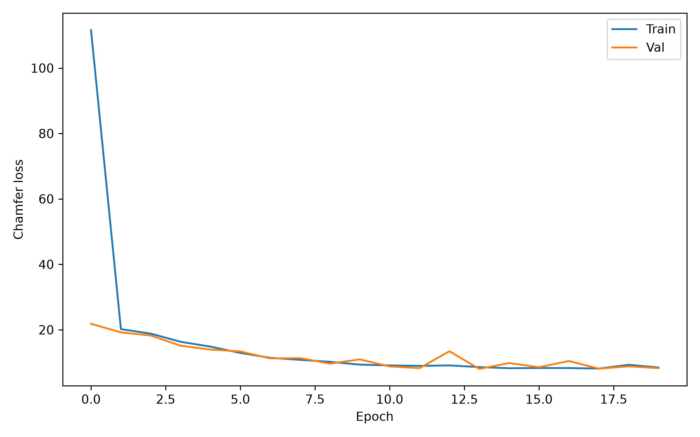{#fig-set-transformer-training-loss-curve width=90%}

\

An output dimension of $64$ corresponds to the number of spatial embedding dimensions used during inference. The candidate output dimensions were intentionally set to always be smaller than the hidden dimension sizes. This forces a compression of information into a fixed-dimensional representation, with additional width in the output layer providing room for added complexity if appropriate, however this may also introduce the risk of losing generalisability if made too wide [@chenAutoEncodersDeepLearning2023]. Furthermore, given that these fixed-dimensional embedding representations serve as features in the downstream classification models, encouraging compression has the added benefit of contributing to dimensionality reduction and thus maintaining a parsimonious feature set.

@leeSetTransformerFramework2019 note that "Since the output of SAB [Set Attention Block] contains information about pairwise interactions among the elements in the input set X, we can stack multiple SABs to encode higher order interaction" (p.3). Here, an SAB is just a hidden layer of the set transformer encoder. As with other deep learning techniques then, additional hidden layers (SABs) generally correspond to the encoding of increased levels of abstract representation between set elements (players). Given that the TPE sampler appeared to find a value of $1$ for the number of hidden layers to be optimal, it would potentially suggest that latent relationships between players within freeze-frames is relatively simple and thus does not require multiple layers of abstraction to produce embedding representation which minimise loss. This seems relatively intuitive, given that freeze-frames consist of $22$ players at most. 

That being said, one might suggest that this could be an artefact of the amount of training time afforded ($10$ epochs), whereby deeper representations require additional training time to update the additional layer parameters. However, @fig-hyperparameter-num-of-layers-loss-comparison shows that, after training $4$ copies of the final model using $20$ epochs on a subset of the train/val/test datasets and varying just the number of hidden layers, a hidden layer size of $1$ still achieves optimal performance. Having $2$ hidden layers appears to achieve near identical loss to having $1$, but it appears that adding more hidden layers leads to loss increasing dramatically. We can also see that the hidden layer sizes of $3$ and $4$ appear to have near constant loss across the training epochs which is much higher than that seen in sizes $1$ and $2$, which also appear to show convergence across the epochs. This constant high loss for hidden layer sizes $3$ and $4$ would suggest that additional model depth is harmful for producing embeddings which minimise reconstruction loss. This provides evidence against the counterargument that deeper models simply might require more training time to converge and instead suggests a shallower encoder is more appropriate for minimising loss.

\

![Comparison of Training Loss Curves for Each Value for Number of Hidden Layers [1, 2, 3, 4]](figures/hyperparameter_num_of_layers_loss_comparison.png){#fig-hyperparameter-num-of-layers-loss-comparison width=90%}

\

### K-means Clustering: Spatial Embeddings {#sec-kmeans}

To explore the spatial representations which may be encoded in these spatial embeddings, we can use k-means clustering on the derived embeddings. Given that not all actions in the dataset have associated freeze-frames, those actions without freeze-frames are assigned embeddings where all dimensions equate to $0$. Since such embeddings do not encode any meaningful information, they are excluded from this clustering analysis, which instead focuses upon embeddings which, in principle, have the possibility of encoding latent representations.

\

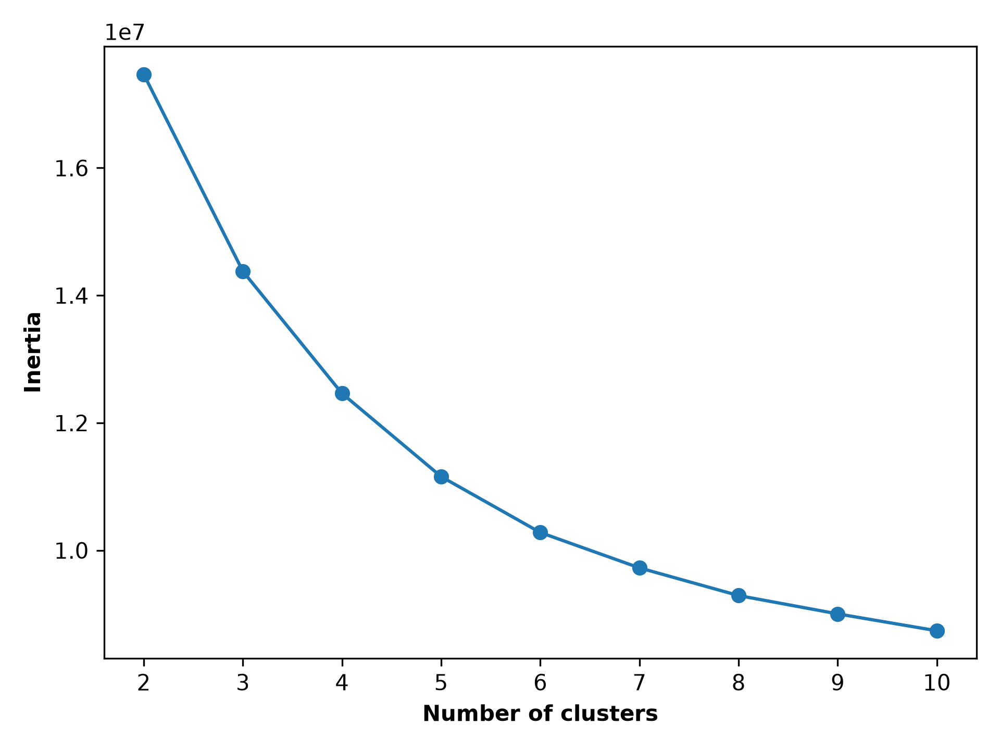{#fig-kmeans-elbow-plot}

\

@fig-kmeans-elbow-plot provides the elbow method plot, indicating the marginal trade-off between the number of clusters $k$ and the inertia of each model. A naive evaluation of this plot would arguably favour $k=3$ as this appears to constitute the "elbow" of the curve, although such a conclusion is inherently subjective. Instead, we can leverage additional model metrics to determine an appropriate value of $k$.

\

```{python} 
#| echo: false
#| label: tbl-kmeans-hyperparameter-results
#| tbl-cap: "K-means Hyperparameter Results"
#| tbl-cap-location: bottom
#| tbl-pos: H

df = (
    kmeans_hyperparameter_results_df
)

def edit_cells(data):
    styles = pd.DataFrame(
        "",
        index=data.index,
        columns=data.columns,
    )
    styles.iat[1, 0] = "background-color: gold;"
    styles.iat[1, 1] = "background-color: gold;"
    styles.iat[1, 2] = "background-color: gold;"
    styles.iat[1, 3] = "background-color: gold;"
    styles.iat[1, 4] = "background-color: gold;"
    return styles

(
    df.style
    .apply(edit_cells, axis=None)
    .hide(axis="index")
    .format({
        "inertia": "{:.2e}",
        "silhouette": "{:.2f}",
        "calinski harabasz": "{:.2e}",
        "davies bouldin": "{:.2f}",
    })
)
```

\ 

@tbl-kmeans-hyperparameter-results instead provides stronger evidence for $k=2$ being the appropriate number of clusters. We can see that $k=2$ produces the highest average Silhouette score ($0.37$), indicating weak clustering, and the lowest Davies-Bouldin index ($1.11$). This additional evidence provides an indication of between-cluster separation and within-cluster compactness, whilst inertia alone considers just compactness. As such, it is arguable that more emphasis be placed on the Silhouette score and Davies-Bouldin index.

Using $k=2$, we can explore the properties of each derived cluster. Below are the heatmaps of each cluster, indicating the average $x$-$y$ co-ordinates of freeze-frames belonging to each cluster, where the attacking direction is from left to right. 

We can see from @fig-heatmap-cluster-0 and @fig-heatmap-cluster-1 that there is a notable difference in average co-ordinates of actions belonging to each cluster. cluster $0$ appears to represent actions around the centre of the pitch, whilst cluster $1$ appears to represent actions occurring just outside and inside the opposition penalty area. Given that their average pitch locations are notably different, we might expect further properties of these clusters to vary also.

\

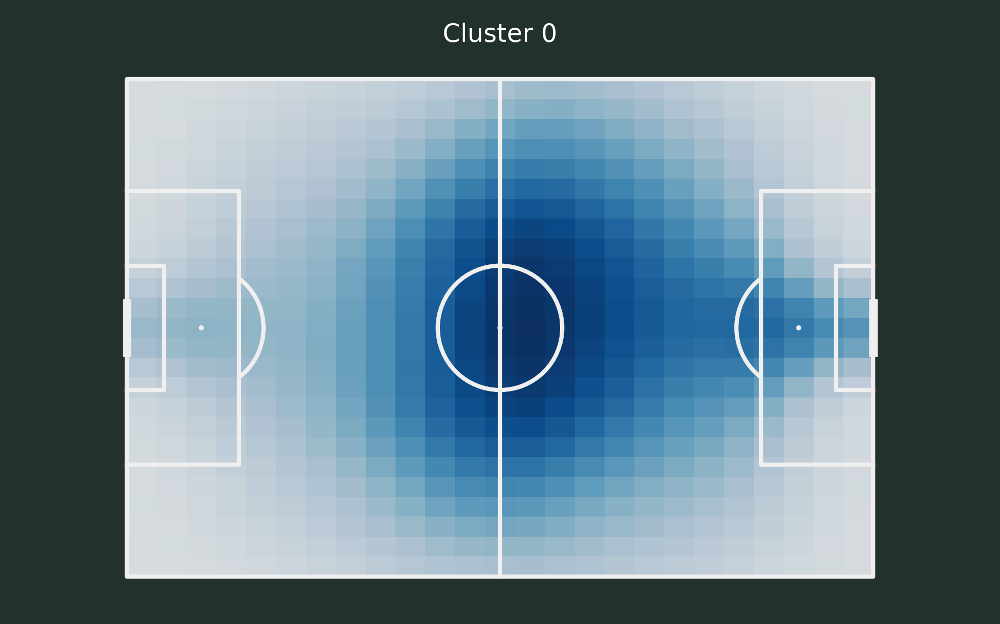{#fig-heatmap-cluster-0}

\

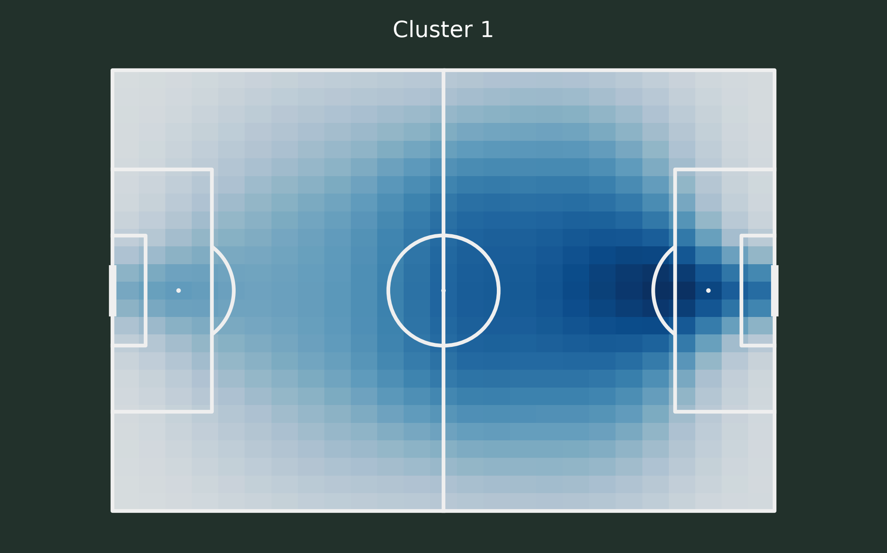{#fig-heatmap-cluster-1}

\

We can also compare each cluster's distribution of VAEP values. Given that we have $2$ clusters where each action has an associated VAEP value, we can use a two-sided $t$-test to examine if the average VAEP values of each of the two clusters significantly differ.

To use a two-sided $t$-test, we typically desire residuals to be normally distributed. Here, the residuals are the differences between each observed VAEP value and the average VAEP of the cluster that observation belongs to. Given that we have a very large sample of spatial embeddings ($n = {776,576}$), the normality assumption can be relaxed as a $t$-test is robust to deviations from residual normality under large ($n \gg 500$) sample sizes [@lumleyImportanceNormalityAssumption2002].

\

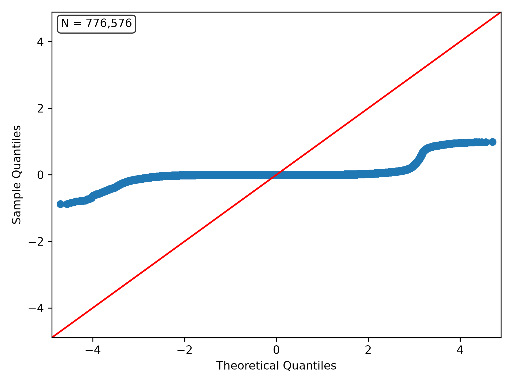{#fig-heatmap-cluster-2}

\

Of greater importance is the assumption of homogeneity of variance, which @tbl-kmeans-vaep-variance-comparison shows is not met by our sample, where cluster $0$ and $1$ show variances of $0.0008$ and $0.0011$, respectively. As such, a variant of the standard $t$-test known as Welch's $t$-test [@welchComparisonSeveralMean1951] can be used, which does not assume equal variance across comparison groups. 

\

```{python}
#| echo: false
#| label: tbl-kmeans-vaep-variance-comparison
#| tbl-cap: "Mean and Variance of VAEP Values for each K-Means Label"
#| tbl-cap-location: bottom
#| tbl-pos: H

df = kmeans_vaep_variance_comparison_df
df.columns = [c.title() for c in df.columns]

(
    df.style
    .hide(axis="index")
)
```

\

Results from the two-sided Welch's $t$-test reveal at a significant difference between group means, $t(489849.35) = -8.71, p < .001, \text{Cohen's} d = .022$. It should be noted that the Cohen's $d$ effect size is very small, indicating that the difference between the means of each group is very small relative to the variation within each group. 

Exploring how the average VAEP value changes across different quantiles of each cluster's distribution of VAEP values shows which parts of the distributions contribute to these averages for each cluster.

\

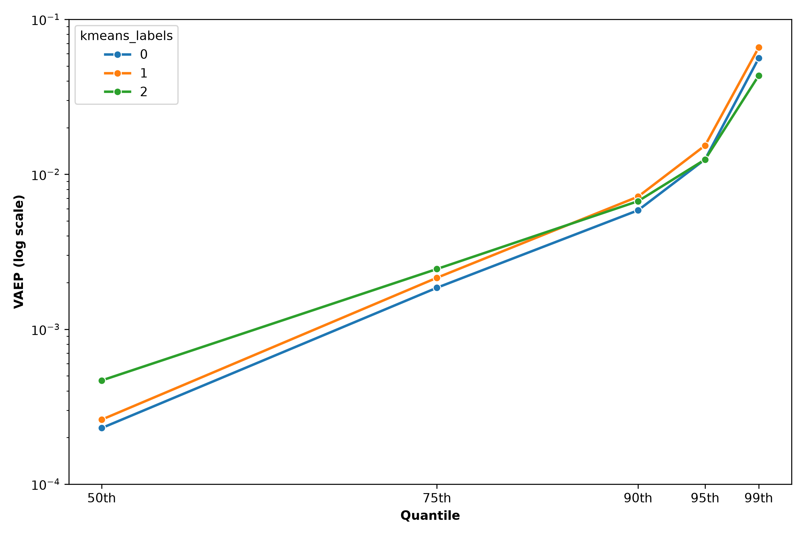{#fig-kmeans-vaep-comparison-quantile}

\

We can see that cluster $1$ shows higher average VAEP values than cluster $0$ across all quantiles from the $50^{th}$ to the $99^{th}$. Given that the overall effect size appears very small, the comparison of average VAEP values across the upper quantiles shows that this difference is somewhat larger for higher-valued actions.

### UMAP

A UMAP can help to visualise the cluster structure within the spatial embeddings. @fig-umap-hyperparameter-range-clusters shows that the two $k$-means clusters occupy broadly distinct regions of the $2$-dimensional UMAP across the tested hyperparameter values, with cluster $0$ generally positioned to the left of cluster $1$. The broad separation between the clusters remains relatively consistent across different values of the number of neighbours and minimum distance, suggesting that this aspect of the embedding structure is not strongly dependent on the selected UMAP configuration. Within each $k$-means cluster, however, there also appears to be a secondary two-region structure. This internal separation becomes increasingly pronounced as the number of neighbours is increased, particularly at larger values of `n_neighbours`. Thus, while the primary distinction between the two $k$-means clusters remains stable, the UMAP suggests weak additional structure within each cluster that is influenced by the scale over which neighbourhood relationships are considered.

\

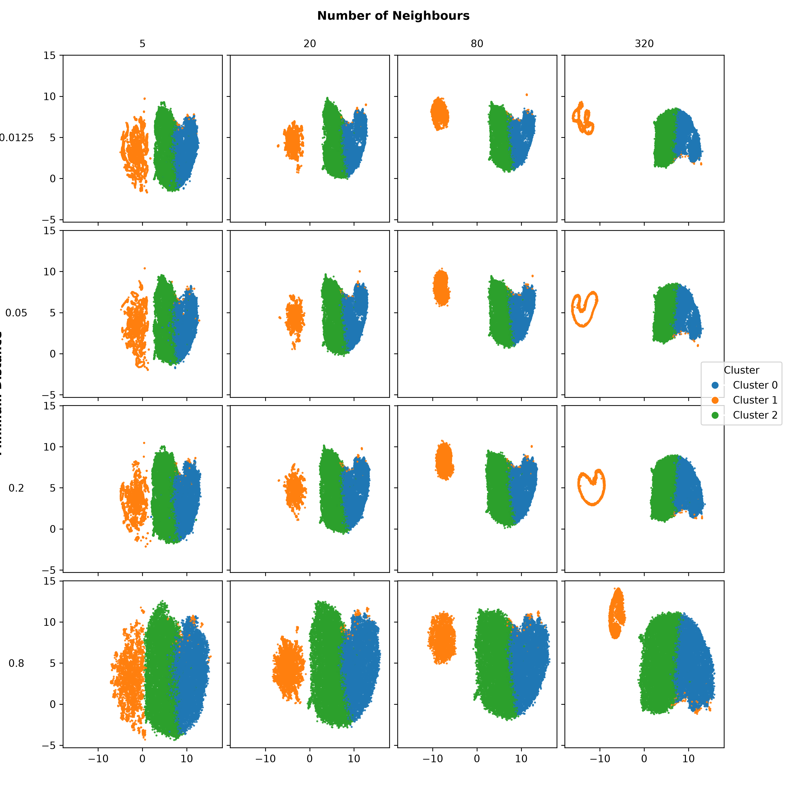{#fig-umap-hyperparameter-range-clusters width=110%}

\

We can explore this potential within-cluster regionality via hierarchical clustering. Agglomerative clustering [@murtaghAlgorithmsHierarchicalClustering2017] iteratively groups data instances together in pairs, whereby the initial data instance form pairs of instances, those pairs are then paired into groups, and so on until the dataset is unified under a single cluster. Several measures can be used to determined which instances are paired together at each iteration. Ward linkage [@murtaghWardsHierarchicalClustering2014] is one such measure, which pairs instances/groups in a manner which minimises the within-cluster sum of squared distances of the resultant merger. This has the effect of maximising compactness within each hierarchical cluster. 

The derived pairings, which each minimise Ward linkage, from the agglomerative clustering algorithm can be plotted using a dendrogram, whereby each paring's associated Ward linkage value are plotted against the $y$-axis. This allows a visualisation of both the hierarchical cluster structure and a measure of by how much each clustering iteration increases the Ward linkage.

To aid computational efficiency, a subsample of $10{,}000$ normalised embeddings were used to produce a dendrogram, enabling inspection of the resulting hierarchical structure.

\

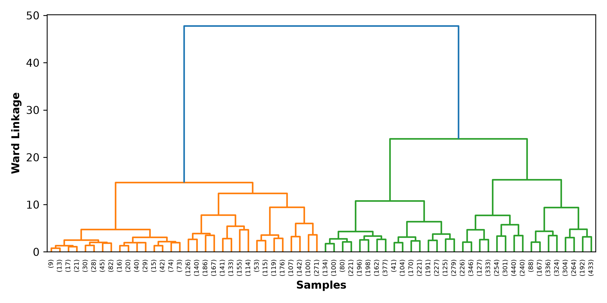{#fig-dendrogram}

\

@fig-dendrogram appears to corroborate the interpretation of the UMAP and the results from $k$-means clustering, whereby we observe two broad clusters, but also evidence of each cluster containing $2$ subclusters, as is suggested by the UMAP in @fig-umap-hyperparameter-range-clusters. These derived clusters from the agglomerative clustering algorithm are in moderately good agreement with those derived from the $k$-means algorithm, achieving an average adjusted rand index (ARI) of $0.564$ across $1{,}000$ random samples each of size $10{,}000$. The sampling distribution can be seen below in @fig-ari-sampling-distribution.

\

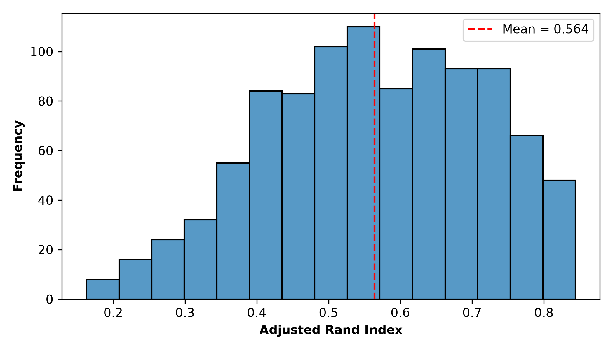{#fig-ari-sampling-distribution}

\

### Spatial Embedding Dimension and Manually-Engineered Feature Correlations

Embedding dimensions alone are not directly interpretable in terms of what constructs they represent, instead any present latent representations are typically spread out across multiple embedding dimensions. However, we can gain some insight into what constructs might be represented within each embedding dimension by correlating them with more interpretable features.

\

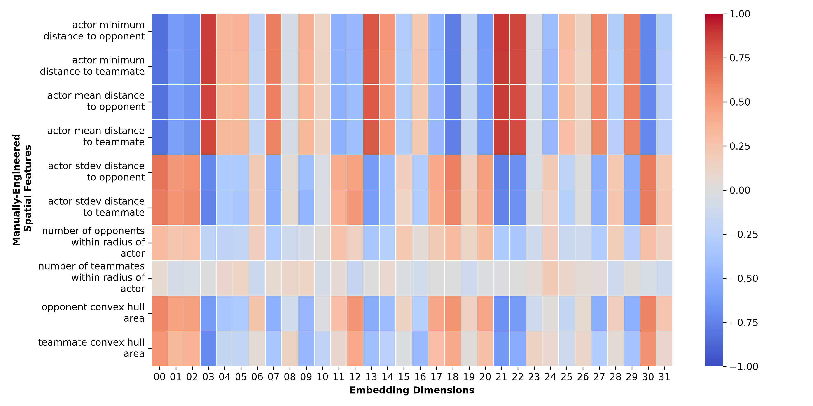{#fig-manual-embeddings-corr-heatmap}

\
 
@fig-manual-embeddings-corr-heatmap shows strong positive correlations between embedding dimensions $13$, $45$ and $51$ and the $4$ manually-engineered actor mean/minimum distances to teammates/opponents features, whereas embedding dimensions $11$, $44$ and $50$ show strong negative correlations with these features. These embedding dimensions therefore seem to relate to spatial information regarding relative distances between the actor and other players.

Interestingly, it does not appear to be the case that any of the embeddings relate to the quantity of players within radius of the actor, with every dimension showing a negligible correlations with these manually-engineered features.

Embedding dimensions $4$, $10$, $23$, $37$, $49$ and $57$ appear to have negligible correlations with all manually-engineered features, indicating that these dimensions potentially contain latent spatial information which is not captured by these manually-engineered features. 

## Classifier Training {#sec-classifier-training}

@tbl-concede-classifier-test-results and @tbl-score-classifier-test-results show the test results from training each of the $32$ classifier models. 

```{python} 
#| echo: false
#| label: tbl-concede-classifier-test-results
#| tbl-cap: "Concedes Classifiers Test Results"
#| tbl-cap-location: bottom
#| tbl-pos: H

df = (
    classifier_test_results_df[classifier_test_results_df["target"] == "concedes"]
    .sort_values(["model", "feature set"], ascending=True)
)

def edit_cells(data):
    styles = pd.DataFrame(
        "",
        index=data.index,
        columns=data.columns,
    )
    styles.iat[15, 3] = "background-color: gold;"
    styles.iat[14, 4] = "background-color: gold;"
    styles.iat[8, 5] = "background-color: gold;"
    styles.iat[14, 6] = "background-color: gold;"
    return styles

(
    df.style
    .apply(edit_cells, axis=None)
    .hide(axis="index")
    .format(precision=6)
)
```

For the concede classifiers, we can see that the XGBoost classifier with the baseline + embeddings feature set (i.e. *embeddings*) performed best in terms of AUC ($0.903$) and log loss ($0.009$). The random forest classifier which included all feature sets (i.e. *all*) showed superior calibration over other concede-based classifiers, with the baseline + manual feature set (i.e. *manual*) CatBoost classifier minimising Brier score.

Overall, the performance of concede classifiers showed a fairly wide range of variation in AUC ($\text{0.798--0.903}$) across the $4$ different classifier techniques, however if the logistic regression classifiers are excluded, this range shrinks somewhat ($\text{0.859--0.903}$).

Logistic regression appeared to benefit most from the introduction of spatial context features, resulting in an increase in AUC from $0.799$ to $0.812$ with the baseline + manually-engineered spatial context feature set (i.e. *manual*). Despite this the *embeddings* feature set saw a very slight reduction in performance in terms of AUC, decreasing from $0.799$ to $0.798$.

By contrast, the $3$ tree-based classifiers all saw a slight improvement in AUC due to the introduction of spatial embeddings and this improvement slightly exceeded that provided by the manual spatial feature set. Despite this, the additional computational overhead introduced by training spatial embeddings compared to creating engineered spatial features arguably does not justify the slight improvement in classifier performance. 

```{python} 
#| echo: false
#| label: tbl-score-classifier-test-results
#| tbl-cap: "Scores Classifiers Test Results"
#| tbl-cap-location: bottom
#| tbl-pos: H

df = (
    classifier_test_results_df[classifier_test_results_df["target"] == "scores"]
    .sort_values(["model", "feature set"], ascending=True)
)

def edit_cells(data):
    styles = pd.DataFrame(
        "",
        index=data.index,
        columns=data.columns,
    )
    styles.iat[13, 3] = "background-color: gold;"
    styles.iat[15, 4] = "background-color: gold;"
    styles.iat[15, 5] = "background-color: gold;"
    styles.iat[15, 6] = "background-color: gold;"
    return styles

(
    df.style
    .apply(edit_cells, axis=None)
    .hide(axis="index")
    .format(precision=6)
)
```

For the score classifiers, the XGBoost classifiers dominate performance. The XGBoost classifier using *manual* features set achieved the best AUC ($0.894$), log loss ($0.034$) and ECE ($0.001$). Furthermore, the *baseline* feature set XGBoost classifier minimised Brier score most strongly ($0.007$).

Overall, the performance of score classifiers showed a slightly narrower range of variation in AUC ($\text{0.807--0.894}$) than with the concede classifiers. Interestingly, rather than the tree-based classifiers showing superior performance in terms of AUC, we can see that the random forest classifier performed worse across all feature sets than logistic regression.

We can see, for each tree-based classifier technique, the introduction of *embeddings* resulted in a reduction in classifier performance compared to the *baseline* feature set, whereas for logistic regression performance improved ($0.873$ to $0.875$). Moreover, for CatBoost, logistic regression and random forest, the *manual* features resulted in reduction in performance, whilst for XGBoost performance appeared to slightly increase.

### Feature Set Significance Tests {#sec-feature-set-significance-tests}

The results outlined in @tbl-concede-classifier-test-results and @tbl-score-classifier-test-results only outline point estimates for classifier performance, and thus we lack sufficient evidence to determine whether the observed variation between classifiers may just be due to random variation. In line with the research objectives, we are particularly interested in whether the observed differences in AUC scores between classifiers using different feature sets *within the same classifier type (concede vs score) and technique* vary significantly. Given that each classifier technique within each type of classifier has $4$ feature sets and we want to compare them pairwise, we have $4 \choose 2$ unique pairwise comparisons to make (i.e. $6$). 

#### Concedes Classifier {#sec-concedes-classifier}

@tbl-concedes-catboost-significance-test to @tbl-concedes-xgboost-significance-test shows no significant pairwise differences, indicating that the addition of spatial context yielded non-significant changes in classifier performance. We therefore lack sufficient evidence to suggest that spatial context improves any of the concede classifiers performance, yet we can also say there is insufficient evidence that spatial context yields a decrease in performance for each classifier technique.

Despite all pairwise differences being non-significant after Holm correction, the effect sizes, whilst small, do show increases in AUC between the *baseline* and *embeddings* feature sets for the tree-based classifiers, whereas logistic regression shows a slight decrease. Moreover, effect sizes suggest the *manual* feature set led to increases in AUC for the logistic regression and random forest concede classifiers, whilst decreases were observed for CatBoost and XGBoost. 

Overall, it would therefore appear that the addition of spatial context features for the concede classifier would yield a very small improvement in classifier performance, but this improvement is mostly limited to the tree-based classifiers and fails to exceed the standard threshold of statistical significance. 

\

```{python} 
#| echo: false
#| label: tbl-concedes-catboost-significance-test
#| tbl-cap: "Concedes Model Feature Set Significance Test Comparison (CatBoost)"
#| tbl-cap-location: bottom
#| tbl-pos: H

df = (
    concedes_catboost_comparison_significance_test_results_df
)

(
    df.style
    .hide(axis="index")
    .format({
        "z": "{:.2f}",
        "p holm": "{:.1g}",
        "delta auc": "{:.2e}",
        "auc 1": "{:.4f}",
        "auc 2": "{:.4f}",
    })
)
```

\

```{python} 
#| echo: false
#| label: tbl-concedes-lr-significance-test
#| tbl-cap: "Concedes Model Feature Set Significance Test Comparison (Logistic Regression)"
#| tbl-cap-location: bottom
#| tbl-pos: H

df = (
    concedes_logistic_regression_comparison_significance_test_results_df
)

def edit_cells(data):
    styles = pd.DataFrame(
        "",
        index=data.index,
        columns=data.columns,
    )
    return styles

(
    df.style
    .apply(edit_cells, axis=None)
    .hide(axis="index")
    .format({
        "z": "{:.2f}",
        "p holm": "{:.1g}",
        "delta auc": "{:.2e}",
        "auc 1": "{:.4f}",
        "auc 2": "{:.4f}",
    })
)
```

\

```{python} 
#| echo: false
#| label: tbl-concedes-rf-significance-test
#| tbl-cap: "Concedes Model Feature Set Significance Test Comparison (Random Forest)"
#| tbl-cap-location: bottom
#| tbl-pos: H

df = (
    concedes_random_forest_comparison_significance_test_results_df
)

def edit_cells(data):
    styles = pd.DataFrame(
        "",
        index=data.index,
        columns=data.columns,
    )
    return styles

(
    df.style
    .apply(edit_cells, axis=None)
    .hide(axis="index")
    .format({
        "z": "{:.2f}",
        "p holm": "{:.1g}",
        "delta auc": "{:.2e}",
        "auc 1": "{:.4f}",
        "auc 2": "{:.4f}",
    })
)
```

\

```{python} 
#| echo: false
#| label: tbl-concedes-xgboost-significance-test
#| tbl-cap: "Concedes Model Feature Set Significance Test Comparison (XGBoost)"
#| tbl-cap-location: bottom
#| tbl-pos: H

df = (
    concedes_xgboost_comparison_significance_test_results_df
)

def edit_cells(data):
    styles = pd.DataFrame(
        "",
        index=data.index,
        columns=data.columns,
    )
    return styles

(
    df.style
    .apply(edit_cells, axis=None)
    .hide(axis="index")
    .format({
        "z": "{:.2f}",
        "p holm": "{:.1g}",
        "delta auc": "{:.2e}",
        "auc 1": "{:.4f}",
        "auc 2": "{:.4f}",
    })
)
```

#### Scores Classifier {#sec-scores-classifier}

\

```{python} 
#| echo: false
#| label: tbl-scores-catboost-significance-test
#| tbl-cap: "Scores Model Feature Set Significance Test Comparison (CatBoost)"
#| tbl-cap-location: bottom
#| tbl-pos: H

df = (
    scores_catboost_comparison_significance_test_results_df
)

def edit_cells(data):
    styles = pd.DataFrame(
        "",
        index=data.index,
        columns=data.columns,
    )
    return styles

(
    df.style
    .apply(edit_cells, axis=None)
    .hide(axis="index")
    .format({
        "z": "{:.2f}",
        "p holm": "{:.1g}",
        "delta auc": "{:.2e}",
        "auc 1": "{:.4f}",
        "auc 2": "{:.4f}",
    })
)
```

\

@tbl-scores-catboost-significance-test shows none of the observed pairwise differences to be statistically significant for the CatBoost score classifier model. Effect sizes show the introduction of the *manual* ($z = -1.26$, Holm-adjusted $p = .800$) and *embeddings* ($z = -1.91$, Holm-adjusted $p = .300$) spatial context features result in a slight reduction in classifier performance compared to the *baseline* feature set. This reduction is minutely more pronounced for the *embeddings* feature set, suggesting the *manual* feature set provided slightly more useful predictive information than the *embeddings*, despite both hurting classifier performance.

\

```{python} 
#| echo: false
#| label: tbl-scores-lr-significance-test
#| tbl-cap: "Scores Model Feature Set Significance Test Comparison (Logistic Regression)"
#| tbl-cap-location: bottom
#| tbl-pos: H

df = (
    scores_logistic_regression_comparison_significance_test_results_df
)

def edit_cells(data):
    styles = pd.DataFrame(
        "",
        index=data.index,
        columns=data.columns,
    )
    styles.iat[0, 2] = "background-color: gold;"
    styles.iat[1, 2] = "background-color: gold;"
    styles.iat[2, 2] = "background-color: gold;"
    styles.iat[3, 2] = "background-color: gold;"
    styles.iat[4, 2] = "background-color: gold;"
    styles.iat[5, 2] = "background-color: gold;"
    return styles

(
    df.style
    .apply(edit_cells, axis=None)
    .hide(axis="index")
    .format({
        "z": "{:.2f}",
        "p holm": "{:.1g}",
        "delta auc": "{:.2e}",
        "auc 1": "{:.4f}",
        "auc 2": "{:.4f}",
    })
)
```

\

@tbl-scores-lr-significance-test outlines DeLong test results for the logistic regression score classifier. We can observe that all pairwise differences are statistically significant following the Holm correction. Whilst the *manual* feature set showed a reduction in performance compared to the *baseline*, the *baseline vs embeddings* comparison showed a significant improvement in classifier performance for the *embeddings* feature set over the *baseline* ($z = 3.03$, Holm-adjusted $p = .002$). Whilst the effect size is quite small ($\Delta\text{AUC} = 0.00192$), this result does provide evidence that the *embeddings* added useful information for scoring classifications for the logistic regression model, beyond what was represented by the manually-engineered features which hurt classifier performance. 

\

```{python} 
#| echo: false
#| label: tbl-scores-rf-significance-test
#| tbl-cap: "Scores Model Feature Set Significance Test Comparison (Random Forest)"
#| tbl-cap-location: bottom
#| tbl-pos: H

df = (
    scores_random_forest_comparison_significance_test_results_df
)

def edit_cells(data):
    styles = pd.DataFrame(
        "",
        index=data.index,
        columns=data.columns,
    )
    styles.iat[0, 2] = "background-color: gold;"
    styles.iat[1, 2] = "background-color: gold;"    
    styles.iat[2, 2] = "background-color: gold;"
    styles.iat[3, 2] = "background-color: gold;"
    styles.iat[4, 2] = "background-color: gold;"
    return styles

(
    df.style
    .apply(edit_cells, axis=None)
    .hide(axis="index")
    .format({
        "z": "{:.2f}",
        "p holm": "{:.1g}",
        "delta auc": "{:.2e}",
        "auc 1": "{:.4f}",
        "auc 2": "{:.4f}",
    })
)
```

\

Regarding the random forest score classifier, @tbl-scores-rf-significance-test again shows $5$ of the $6$ pairwise differences to be statistically significant. Both the *manual* ($z = -5.48$, Holm-adjusted $p < .001$) and *embeddings* ($z = -7.34$, Holm-adjusted $p < .001$) feature sets resulted in a significant reduction in classifier performance compared to the *baseline*. Considering the *embeddings vs manual* comparison yielding a non-significant difference ($z = 1.51$, Holm-adjusted $p = .100$), we lack sufficient evidence to determine which spatial context feature set hurts the performance of this classifier more. 

\

```{python} 
#| echo: false
#| label: tbl-scores-xgboost-significance-test
#| tbl-cap: "Scores Model Feature Set Significance Test Comparison (XGBoost)"
#| tbl-cap-location: bottom
#| tbl-pos: H

df = (
    scores_xgboost_comparison_significance_test_results_df
)

def edit_cells(data):
    styles = pd.DataFrame(
        "",
        index=data.index,
        columns=data.columns,
    )
    styles.iat[0, 2] = "background-color: gold;"
    styles.iat[2, 2] = "background-color: gold;"
    return styles

(
    df.style
    .apply(edit_cells, axis=None)
    .hide(axis="index")
    .format({
        "z": "{:.2f}",
        "p holm": "{:.1g}",
        "delta auc": "{:.2e}",
        "auc 1": "{:.4f}",
        "auc 2": "{:.4f}",
    })
)
```

\

Lastly, @tbl-scores-xgboost-significance-test outlines DeLong test results for the XGBoost score classifier. $2$ of the $6$ pairwise comparisons made were statistically significant, whereby the *baseline* feature set significantly exceeds performance of the XGBoost classifier using *all* feature sets ($z = 2.70$, Holm-adjusted $p = .030$). The significant *all vs manual* comparison ($z = 3.55$, Holm-adjusted $p = .002$) and the non-significant *baseline vs manual* comparison ($z = 0.27$, Holm-adjusted $p = .900$) suggest the *embeddings* feature set hurts classifier performance, whilst the *manual* feature set does not yield a significant change in performance over the baseline.

### Classifiers Used for VAEP in this Project {#sec-classifiers-used-in-project}

Given the results outlined in @sec-classifier-training, @sec-concedes-classifier and @sec-scores-classifier, the overall best performing classifier techniques was XGBoost, for both scoring and conceding predictions. Specifically, the *embeddings* XGBoost concede classifier and the *manual* features XGBoost score classifier achieved the best AUC scores, despite the performance of these feature sets not being significantly different from their respective *baseline* counterparts. However, on this basis, the classifiers used to produce VAEP scores are these two classifiers. 

### Valuing Actions by Estimating Probabilities (VAEP) EDA

As seen in @decroosActionsSpeakLouder2019, it may also be useful to assess how derived VAEP values behave and align with domain-specific intuition. It is desirable for derived metrics in any domain to display strong face validity, that is, the metric should provide a well-calibrated and "plausible" [@jacobsMeasurementFairness2021, pp. 5] measure of the phenomenon it is intended to capture. In measuring action value, one inherent limitation is that action-valuation metrics like VAEP lack a "ground truth" upon which to draw comparisons [@decroosVAEPObjectiveApproach2020]. There is no objective measure of action value that we can observe in the world beyond what is provided by the very action-valuation metrics researchers have developed. Given that such metrics are intended to provide a quantitative measure of action value, assessing face validity is fraught with subjectivity, and it is thus somewhat trivially obvious that this issue arises. 

#### "The Messi Test"

One heuristic used in sports analytics is to compare derived action or player valuations with the intuitions of both technical and non-technical domain experts. For instance, @pappalardoPlayeRankDatadrivenPerformance2019 calibrate their PlayeRank metric by assessing its agreement with a panel of experienced football scouts. Regarding the period of time which publicly available events data, such as those provided by StatsBomb, covers, it is widely regarded that players such as *Lionel Messi* and *Atiana Bonmati* constitute one of the most, if not the most, valuable male and female players in world football, respectively (For example, they both lead the all-time most number of Ballon d'Or wins by a single player for their respective gender [$8$ and $3$, respectively], @BallonDOr2026; @BallonDOrFeminin2026). Dubbed "the Messi test", the heuristic suggests that an action value metric displays strong face validity if it correctly rates players who are widely regarded as being exceptionally talented as highly performing.

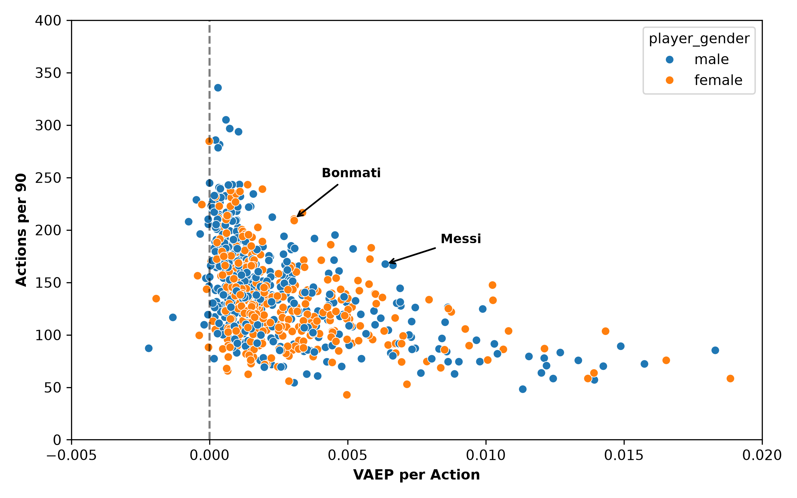{#fig-vaep-per-action-actions-per-90 width=100%}

\

We can see from @fig-vaep-per-action-actions-per-90 that our "Messi/Bonmati test" appears to have been passed successfully. The plot includes players who have player more than $270$ minutes across the competitions included in this project's dataset and compares the number of actions they perform per $90$ minutes of playtime with the average VAEP value of the set of actions they took. We would expect more valuable players to exhibit both high volume (actions per $90$) and high quality (VAEP per action) across their playtime and action sets. We can see that both *Messi* and *Bonmati* are positioned on the upper frontier of the scatter plot, exactly where valuable players would be expected to appear. Furthermore, the derived VAEP per action values fall within the same magnitude as that observed in @decroosActionsSpeakLouder2019, indicating some degree of agreement in valuation with previous VAEP models. The number of actions is likely generally higher than seen in @decroosActionsSpeakLouder2019 as this project uses atomic-SPADL actions, rather than standard SPADL actions.

#### VAEP Player Ratings & Player Market Value

Using the VAEP player rating formula provided in @eq-vaep-player-rating, we can assign ratings to each player in our dataset. @tbl-male-vaep-ratings and @tbl-female-vaep-ratings outline the top-$10$ VAEP player ratings for male and female footballers, respectively. Whilst *Bonmati* does not appear in the women's top-$10$, presumably due to their lower VAEP per action score, *Messi* does appear and with considerably higher minutes played than the rest. Each table is dominated by players who play in attacking positions, with *Hinata Miyazawa* being the only player to not do so.

\

```{python}
#| echo: false
#| label: tbl-male-vaep-ratings
#| tbl-cap: "Top-10 VAEP Player Ratings (Male)"
#| tbl-cap-location: bottom
#| tbl-pos: H

df = top10_vaep_player_ratings_male_df

(
    df.style
    .hide(axis="index")
    .format({
        "market_value_in_eur": "€{:,.2f}",
        "minutes_played": "{:.1f}"
    })
)
```

\ 


\ 

```{python}
#| echo: false
#| label: tbl-female-vaep-ratings
#| tbl-cap: "Top-10 VAEP Player Ratings (Female)"
#| tbl-cap-location: bottom
#| tbl-pos: H

df = top10_vaep_player_ratings_female_df

(
    df.style
    .hide(axis="index")
    .format({
        "minutes_played": "{:.1f}"
    })
)
```

\ 

@decroosActionsSpeakLouder2019 also explore how their derived VAEP player ratings relate to the market value of players. The authors report the top-$10$ rated Premier League players from the $2017/18$ season along with their VAEP player ratings for that season (see Table 1d in their article). For our present data, only male football have sufficient market value data available to use, and this was collected from Transfermarkt [@FootballTransfersRumours], using the Reep register [@ReepFootballIdentity] to ensure player valuations were assigned to the correct StatsBomb player IDs. Player valuations represent their most recent recorded market valuation since $01/08/2025$.

\

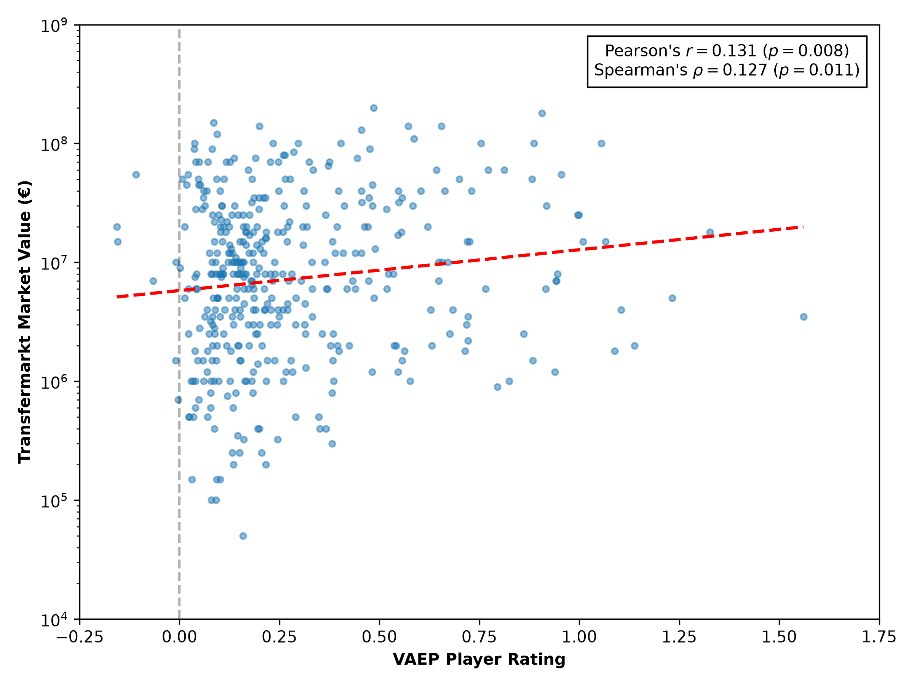{#fig-vaep-rating-market-value-scatterplot width=90%}

\

Whilst market valuation is not entirely determined by the average value of the players set of actions of some time interval, @fig-vaep-rating-market-value-scatterplot does affirm our intuition that players who provide more valuable actions are generally valued more highly in the market, whereby a small, statistically significant, positive Spearman's rank correlation was observed between VAEP player rating and logarithmic Transfermarkt market valuation, $\rho = .116,\,p=.02,\, N=405$.

#### Comparing Classifier VAEP Valuations of Action Sequences

Beyond exploring qualitative evidence that derived VAEP values correspond to intuition and proxy measures of player and action value, we can also qualitatively explore how our different VAEP feature sets change how each classifier values actions. Taking a single case study, we can explore to what extent VAEP valuations vary between features sets within a given classifier technique (i.e. XGBoost) and how valuations vary across classifier techniques for a fixed feature set (i.e. *baseline*). @fig-action-sequence is a visualisation of the sequence of atomic actions leading to *Di María's* goal in the 2022 FIFA Men's World Cup, with the surrounding spatial context included.

\

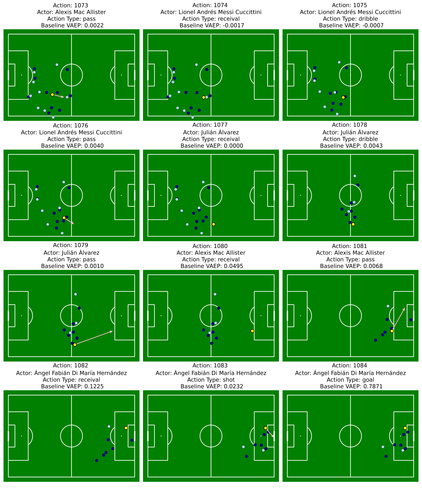{#fig-action-sequence}

\ 

@tbl-action-sequence-vaep-values shows a comparison of the VAEP valuations from each feature set variant of the score and concede XGBoost classifiers. 

\

```{python}
#| echo: false
#| label: tbl-action-sequence-vaep-values
#| tbl-cap: "Comparison of VAEP Valuations from Each XGBoost Feature Set of Action Sequence from the 2022 FIFA Men's World Cup Final (Di María's 36th Minute Goal Build-up)"
#| tbl-cap-location: bottom
#| tbl-pos: H

df = action_sequence_vaep_values_df.drop("player", axis=1)

df.columns = [c.replace("_", " ") for c in df.columns]

(
    df.style
    .hide(axis="index")
    .format({
        "vaep value baseline": "{:.4f}",
        "vaep value manual": "{:.4f}",
        "vaep value embeddings": "{:.4f}",
        "vaep value all": "{:.4f}"
    })
)
```

\ 

Action $1076$ shows some slight variation in valuations, whereby the *embeddings* feature set appears to slightly down-value the action compared to the other feature sets. This may potentially be due to the presence of two opponents in the immediate vicinity of the actor and thus such a pass may appear more similar to passes which are intercepted by a nearby opponents, hence the slight devaluation of the action. Qualitatively, this devaluation does appear to be a mistake by this feature set as we know this pass initiates the counterattack which results in a goal. This might provide some limited insight into why the *embeddings* feature set did not yield as much of a positive impact on classifier performance as these embeddings provide very similar representations for such actions that are risky but successful and those which are simply unsuccessful. Given that the embedding representations themselves cannot differentiate the *quality* of the action, only the spatial context, these similar embeddings representations may lead to a sort of regression to the mean whereby similar spatial contexts are treated similarly by the classifier. As such, the embeddings may fail to provide valuable classification information for genuinely valuable actions such as action $1076$ as they appear very similar to a larger volume of actions which are not successful or valuable.

Action $1078$ appears to be valued more highly by the spatial context feature sets (*manual*, *embeddings* & *all*) than the *baseline*. Given the freeze-frame for this action, we can see that the actor appears to be afforded relatively open space in front of them which may explain the variation. The following action $1079$ is valued positively by the *baseline* feature set but negatively by the spatial context feature sets. This again may provide some limited insight into why the spatial context features did not generally improve classifier performance, as the spatial context of this pass looks similar to an overhit pass which would typically run through to the opposition goalkeeper and therefore not result in a goal being scored and instead concede possession which would increase the probability of subsequently conceding. This action is a direct example of the addition of spatial context (at least in the way it is represented presently) hurting classifier performance.

An interest pattern is observed for action $1080$, which is a very valuable receival. Each classifier correctly assigns a positive VAEP value to the action, but it appears the *embeddings* feature set values this action most strongly. We can see why from the freeze-frame as it would appear to show the player receiving the pass in a massive amount of open space. This however, appears to be an artefact of the lack of resolution provided by the freeze-frames as in reality the opposition players were much closer to the actor during this action than they appear to be [see @fifaChampionsArgentinaAll2026 @ 09:53]. The freeze-frames themselves thus better fit SPADL-formatted actions rather than atomic-SPADL, where the splitting of passes into the pass and the reception of the pass means the reception uses the freeze-frame of the prior pass, potentially failing to capture the correct spatial context at the moment of the reception. The *embeddings* feature set is therefore "correctly" increasing the value of this action based on the information it is being provided, the issue is instead more so with the spatial context information itself. Despite the *embeddings* feature set appearing to increase the value assigned to this action and the *manual* feature set only slightly decreasing the value, it appears including *all* feature sets leads to this action being undervalued by a notable margin compared to the *baseline* and so potentially the interaction between manually-engineered and embedding features may disrupt the more typical valuation behaviour. 

Regarding the goalscoring shot from *Di María* (action $1083$), we can see that the *manual* and *embeddings* feature sets appear to more strongly value this shot compared to the *baseline*. This may be due to how most of the opposition players are all positioned towards the actor's right-hand side whereas shots from similar locations may have opposition players in configurations nearer to the actor and thus the probability of scoring is lower. The *baseline* would have no spatial context for such shots.

\

```{python}
#| echo: false
#| label: tbl-action-sequence-vaep-values-techniques
#| tbl-cap: "Comparison of Baseline VAEP Valuations from Each Classifier Techniques of Action Sequence from the 2022 FIFA Men's World Cup Final (Di María's 36th Minute Goal Build-up)"
#| tbl-cap-location: bottom
#| tbl-pos: H

df = action_sequence_vaep_values_techniques_df.drop("player", axis=1)

df.columns = [c.replace("_", " ") for c in df.columns]

(
    df.style
    .hide(axis="index")
    .format({
        "vaep value logistic regression": "{:.4f}",
        "vaep value random forest": "{:.4f}",
        "vaep value catboost": "{:.4f}",
        "vaep value xgboost": "{:.4f}"
    })
)
```

\

Regarding variation between classifier techniques using the *baseline* feature set, we can see some notable variations in @tbl-action-sequence-vaep-values-techniques. Firstly, action $1078$ sees agreement between logistic regression and random forest for a fairly low VAEP value ($0.0001$), a slightly higher valuation from XGBoost ($0.0043$) and a much higher valuation from CatBoost ($0.0118$).

Action $1083$ also sees CatBoost assign a much higher valuation to the action than the other techniques, which in this example arguably correctly identifies the value of the shot given that we know post-hoc it results in a goal.

## Model Interpretation

### Permutation Importance

Beyond assessing the performance and face validity of the VAEP classifier models, we may also attempt to interpret which features are most influential in the decisions made by these classifiers. By exploring permutation importance, we can accumulate evidence to indicate which features are most impactful in enabling strong classification performance.

#### Grouped Permutation Importance

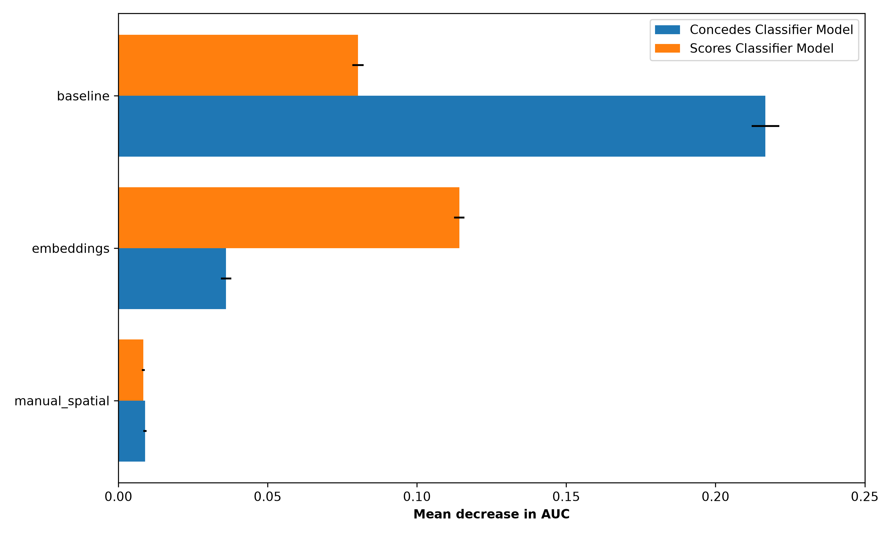{#fig-grouped-permutation-importance width=80%}

@fig-grouped-permutation-importance shows the average decrease in AUC (across $10$ iterations) due to the random permutation of *baseline* features, spatial embeddings (*embeddings*) and manually-engineered spatial features (*manual*). 

For the selected concede and score classifiers (see @sec-classifiers-used-in-project), the *baseline* feature set dominates as most important for determining the classifier's predictions. Due to random permutations of these *baseline* features, AUC, on average, reduces by around $0.3$ for the concede classifier and $0.38$ for the score classifier.

By contrast, and matching the pattern observed in @sec-feature-set-significance-tests, the random permutation of the *embeddings* and *manual* feature sets do not yield a particularly large average reduction in AUC. However, we can observe that the permutation importance of the *embeddings* feature set is larger for the concede classifier than for the score classifier, which is in line with the pattern of observations made in @sec-concedes-classifier, where we observed a non-significant increase in the concede XGBoost classifier performance upon the addition of the *embeddings* feature set to the *baseline*, whilst this addition instead hurt model performance for the score XGBoost classifier, albeit non-significantly.

#### Baseline Feature Set Permutation Importance

We can zoom in on each individual feature which constitutes the *baseline* feature set to examine which carries importance for each prediction task (score or concede). Given that each feature in the model has an additional $9$ lagged variants (to reflect the $k=10$ previous actions), each feature will be very highly correlated with its own lagged variants. As such, it would be more appropriate to group together each feature with its lagged variants before evaluating the permutation importance of each feature. This evaluation uses the XGBoost concede and score models trained on the *baseline* feature set only.

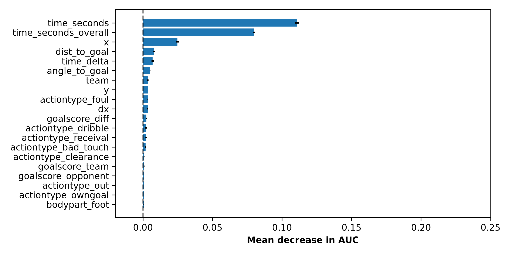{#fig-concede-permutation-importance-baseline}

@fig-concede-permutation-importance-baseline reveals the current time (in seconds) of the set of actions (i.e. the gamestate) within the $k=10$ window of the current action to be the most important features. We can also see that the `x` co-ordinate of the gamestate and its distance to the opponent's goal (`dist_to_goal`) also appear to be important features. It would appear then that much of the concede XGBoost *baseline* classifier performance can be attributed to knowing the time at which an action occurred, along with its $x$ co-ordinate or Euclidean distance to the opponent's goal. This may be somewhat unsurprising, as we might intuitively expect the probability of an action resulting in conceding a goal to depend on where on the pitch and when during the match the action occurred.

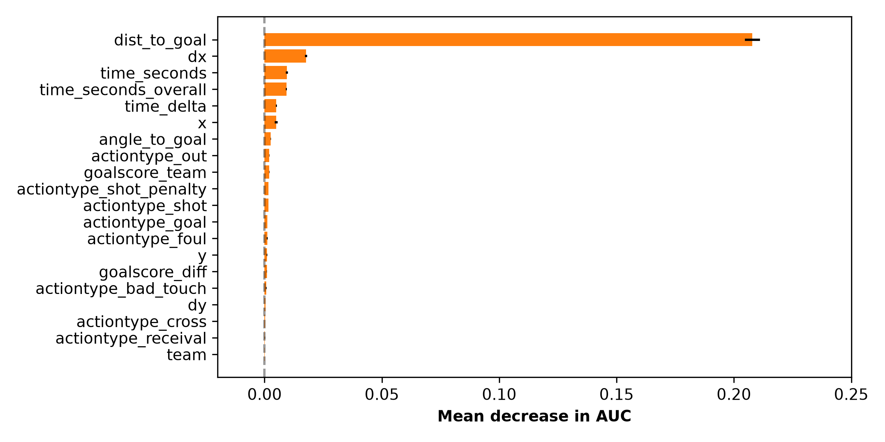{#fig-score-permutation-importance-baseline}

@fig-score-permutation-importance-baseline shows some similarities in *baseline* feature importance for the score classifier as the concede classifier. Again, we observe timestamp and distance to goal features to be amongst the most important. However, we can see that the `dist_to_goal` of the gamestate appears far more important than any other *baseline* feature for predicting a goal being scored within the next $k$ actions. Again, this both matches intuition, as we might expect goal scoring to be easier the closer a player is to the opponent's goal, and empirical probabilities estimated by alternative action-valuation models like expected goals (xG) or expected threat (xT). 

#### Manually-Engineered Feature Set Permutation Importance

We can additionally examine the importance of the manually-engineered features by exploring their permutation importance as part of the concede and score XGBoost *manual* feature set classifiers. We should note that, for each of these plots, the scale of the $x$-axis is around $10\times$ smaller than that of the *baseline* feature performance plots and so these observed importances are still relatively minuscule. 

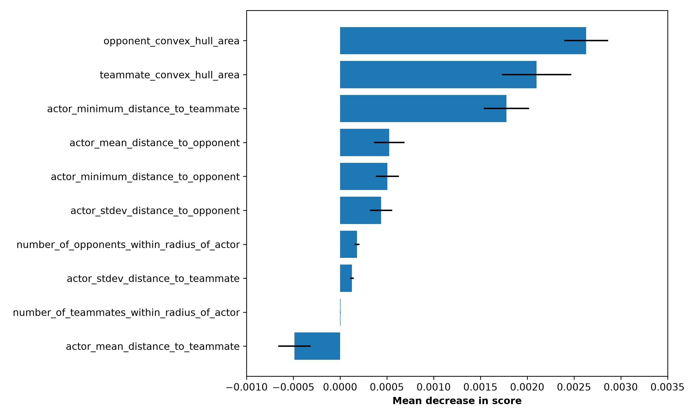{#fig-concede-permutation-importance-manual}

@fig-concede-permutation-importance-manual shows that the average distance of the actor to the opponents, their minimum distance to a teammate and the convex hull areas of both teammates and opponents to be the most important manually engineered features. Spatial context of how close the actor is to opponents, if they are close to a teammate and the how spread-out teammate and opponent formations are each contribute most to estimating concede probabilities.

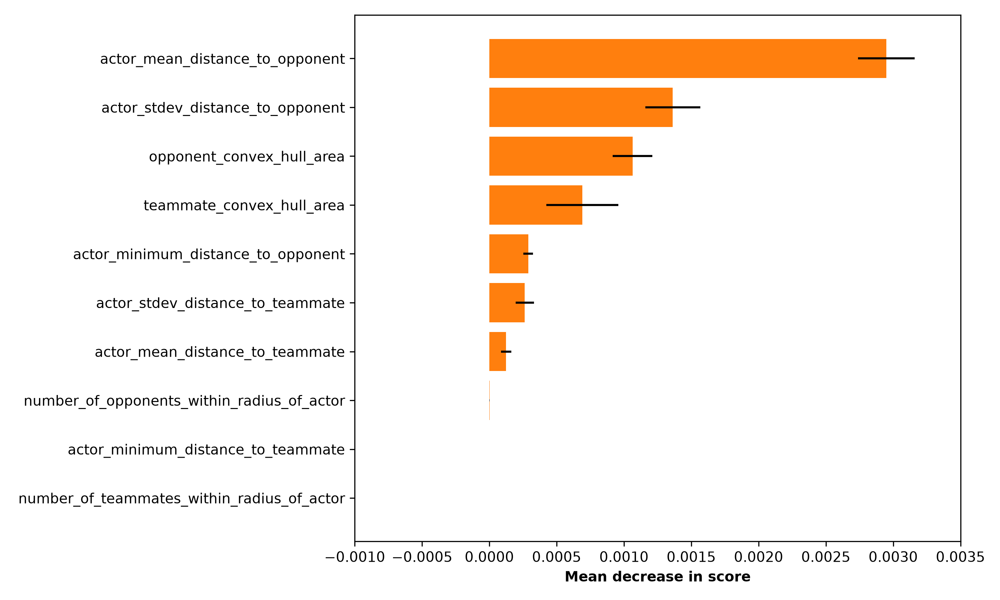{#fig-score-permutation-importance-manual}

By contrast, @fig-score-permutation-importance-manual shows the standard deviation of the distances between the actor and their teammates to be the most important manually-engineered spatial feature for the score classifier. This would suggest the most useful spatial context for estimating scoring probabilities revolves around how much variation there is in distances between the actor and their teammates. Such a finding might indicate that a more or less structured attacking shape changes the probability of scoring within $k$ events, where less variation in teammate distances would indicate a more organised team structure than might be observed if there is large variation in the distances of teammates to the actor.

#### Spatial Embedding Dimensions Permutation Importance

@fig-concede-permutation-importance-embeddings and @fig-score-permutation-importance-embeddings outlines which embedding dimensions were most important for each type of classifier. We can see that for the concede classifier, embedding dimensions $26$, $48$ and $24$ constitute the top $3$ most important, with $46$, $52$ and $18$ being most important for the score classifier. 

With reference to @fig-manual-embeddings-corr-heatmap, the top $3$ concede classifier embedding dimensions show slight positive correlations with relative actor to teammate/opponent distance metrics (dimension $24$), slight negative correlations with teammate/opponent convex hull area (dimensions $26$ & $48$) and slight positive correlations with the number of teammate/opponents within $10$m of the actor (dimension $48$). The top $3$ score embedding dimensions relate somewhat to relative actor to teammate/opponent distance metrics (negative for dimension $18$, positive for dimension $52$), moderate relationships with teammate/opponent convex hull area (positive for dimension $46$, negative for dimension $52$). The embedding dimensions with the strongest correlations to manually-engineered spatial features do not appear to be particularly important for the concede classifier, but are more so for the score classifier, whereby dimensions $11$, $13$, $45$ and $50$ rank amongst the top-$20$ most important embedding dimensions.

\

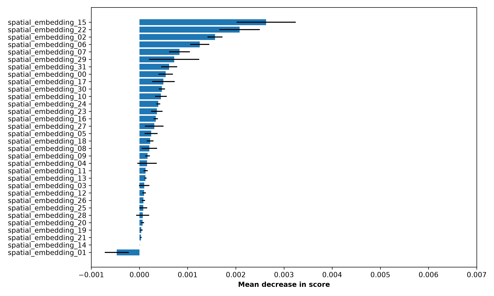{#fig-concede-permutation-importance-embeddings}

\

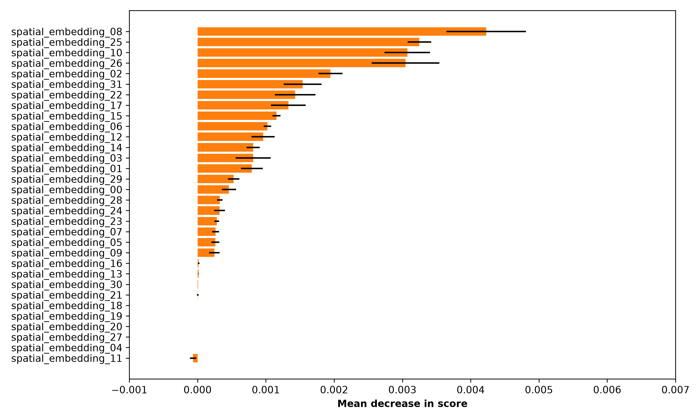{#fig-score-permutation-importance-embeddings}

\

### Partial Dependence Plots

Through partial dependence plots, we can explore how the predicted probability of scoring or conceding within $k$ actions changes as we vary single feature.

As identified earlier, the most important baseline features for the concede and score classifiers were the `time_seconds` and `dist_to_goal` features, respectively. @fig-pdp-concede-most-important shows their respective partial dependencies. 

\

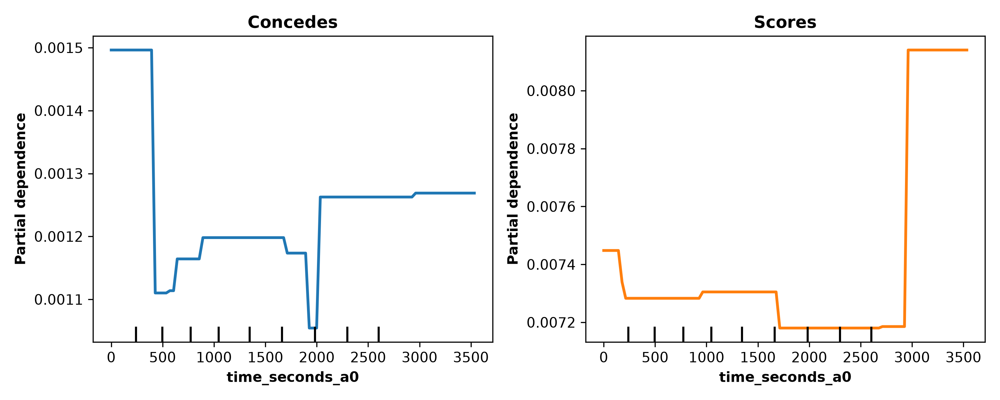{#fig-pdp-concede-most-important}

\

The concede classifier plot shows the probability of conceding is higher during the first $450$ seconds ($5$ minutes) of a half (`time_seconds` is the time elapsed in the current half, not the absolute time elapsed) compared to the rest of the half, where after $2{,}000$ (around the $33^{rd}$ minute of the half) the probability increases again. 

The score classifier plot shows an alternative pattern. Whilst the overall probability estimates are much higher than with the concede classifier, it appears that the predicted probability of scoring only slightly decreases over the course of each half, with the jump in probability occurring during first and second half stoppage time periods (i.e. $> 3{,}000$ seconds).

\

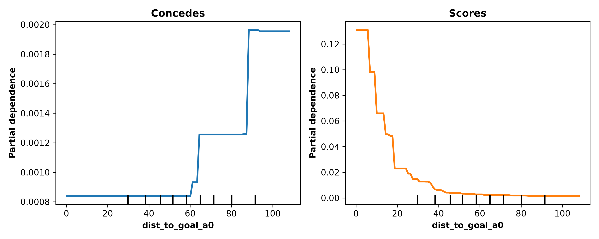{#fig-pdp-score-most-important}

\ 

Regarding `dist_to_goal`, we can see patterns in @fig-pdp-score-most-important which largely match our intuitions. For the concede classifier, the estimated probability of conceding increases exponentially as the distance of the action from the opponent's goal increases (i.e. as the action gets closer to the actor's own goal). Moreover, the score classifier shows the opposite pattern, where by as the distance from goal increases, the estimated probability of scoring within $k$ events decreases exponentially. This again generally aligns with the pattern of action valuation provided by alternative models like xG and xT, which both assign higher action value to actions closer to the opponent's goal.

\ 

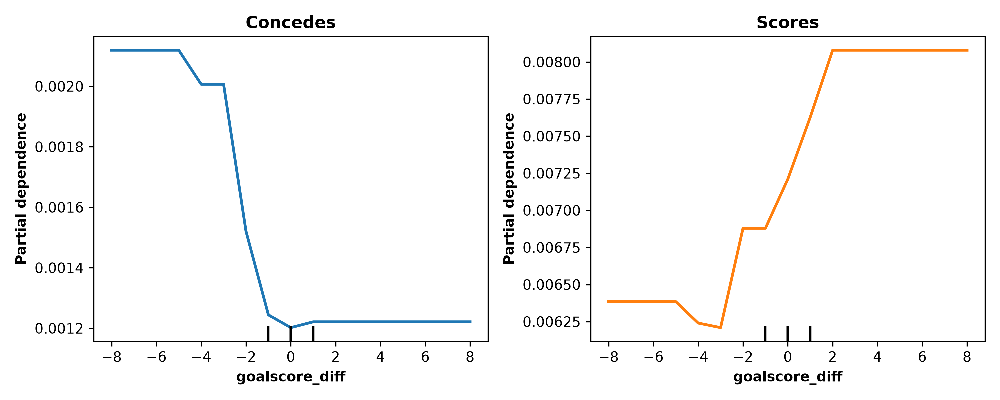{#fig-pdp-goalscore-diff}

\

A further sense-check can be observed in @fig-pdp-goalscore-diff, whereby the estimated probability of conceding is higher when the actor's team is losing, with that probability increasing exponentially, whilst the estimate probability remains constant as the goal difference increases above $0$. The score classifier again shows a mostly opposite pattern, whereby the estimated probability of scoring remains low until the goal difference reaches $-3$, upon which we see an exponential increase until the goal difference reaches $2$ and the estimated probability plateaus.

\ 

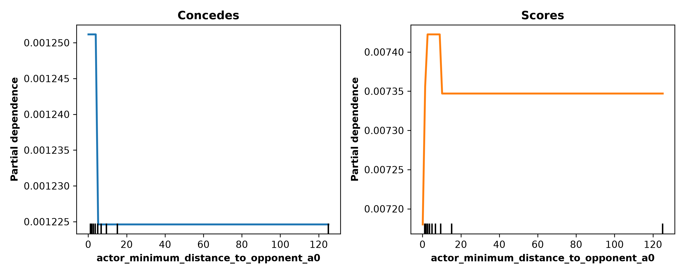{#fig-actor-minimum-distance-to-opponents}

\

Inspecting @fig-actor-minimum-distance-to-opponents showing the PDP of the actor's minimum distance to opponents, using the *manual* feature set classifiers, we can see again a mostly inverted relationship across the concede and score classifiers. The concede classifier suggests the predicted probability of conceding exponentially decreases once there are no opponents within around $10$ meters of the actor, which is very intuitive. Likewise, the score classifier shows a sharp increase in the probability of scoring as the minimum opponent distance increases, plateauing at around $15$ meters. It should be noted that the scale of the $y$-axis is quite small, so these observed changes, whilst large in a relative sense, do not correspond to large absolute probabilities. Furthermore, the black ticks on the x-axis indicate the distribution of quantiles of the dataset, where we can see most of the data is congregated around the sharp changes in probability. The remaining plateaus are thus likely representative of a very small sample of actions which the classifiers assign roughly equal probabilities to.

# Discussion

This project aimed to explore how the addition of spatial context features altered, if at all, the performance and behaviour of the VAEP Model using the full sample of events from $6$ UEFA and FIFA tournaments across Men's ($3$) and Women's ($3$) football. By engineering feature representations of the spatial context surrounding the actor during a given action, using StatsBomb's $360$ freeze-frame data, the standard SPADL feature set typically used in the construction of VAEP models was accompanied and the change in performance and behaviour assessed. 

@sec-manual-spatial-feature-engineering outlines how the manually-engineered feature set was generated from $360$ freeze-frames, whereby $10$ features were generated to represent different aspects of spatial context relating to both teammates and opponents, respectively. As for the spatial embeddings, these were generated by training an encoder-decoder architecture using a weighted Chamfer distance + binary cross-entropy loss function, with the objective to minimise reconstruction loss from reconstructed player sets produced by an MLP decoder using the embeddings generated from a set transformer decoder. We observed how the optimal hyperparameters derived from the TPE sampler resulted in a shallow encoder model, constituting just $1$ hidden layer. We saw how additional layers, holding all other hyperparameters constant, did not yield improved test performance, even with additional training opportunity ($20$ rather than $10$ epochs). This hyperparameter configuration, rather than being indicative of a lack of complexity in the spatial structure of football players during actions, may instead be indicative of the simplicity of the freeze-frame data itself, which does not provide additional detail of aspects of spatial context like player velocities. Contrasting freeze-frames with the more typical approach of using tracking data, freeze-frames artificially reduce spatial context to snapshots which fail to capture useful spatiotemporal information such as player movement velocities [@goesUnlockingPotentialBig2021]. Nonetheless, we saw in @sec-kmeans that the derived spatial embeddings appear to weakly represent two broad sets of spatial configurations, with cluster $0$ capturing actions within central areas of the pitch, whilst cluster $1$ appeared to focus more on actions in and around the opposition penalty area. These clusters also appeared to significantly vary in their associated VAEP values, whereby actions associated with cluster $1$ embeddings showed an increased average VAEP value compared to those from cluster $0$. Since the most notable distinction between the clusters revolved around their average $x$ co-ordinate position, such findings are perhaps unsurprising given the features made available via freeze-frame data.

Regarding classifier performance, we observed in @sec-classifier-training an ablation design which compared the performance each of the $4$ feature sets across each classifier technique for both the concede classifier and score classifier, respectively: the traditional SPADL feature set (*baseline*); baseline + manually-engineered spatial features (*manual*); baseline + spatial embeddings (*embeddings*); and baseline + manually-engineered spatial features + spatial embeddings (*all*). Despite the manually-engineered features capturing theoretically-relevant aspects of spatial context, and the embeddings seeming to capture genuine latent spatial information, the results from pairwise Delong tests did not support the notion that such features made significant changes to VAEP model performance. This was further compounded by assessments of grouped permutation importance, whereby for each score and concede XGBoost classifier using *all* feature sets, we saw both the manually-engineered features and the spatial embeddings features were drastically less important than the *baseline* feature set. These findings deviate from alternative action-valuation models. As discussed previously,  @everettContextualExpectedThreat2022 found a small improvement to model fit when introducing spatial context features to the expected threat (xT) model. @cefisNewXGModel2025 likewise find spatial context features to improve model performance, whereby their logistic regression expected goals (xG) model found spatial context features to contribute significantly to model predictions. One potential reason why the introduction of spatial context did not yield significant improvements in classifier performance (except for the logistic regression score classifier) is that VAEP does already contain some spatial information. Whilst not modelling the context of surrounding players to the actor, and thus not modelling spatial context, VAEP does provide the location of the actor across a sequence of $k$ actions my providing the $i-1$ to $i-k$ lagged variants of the $x$ and $y$ actor co-ordinates as classifier features. Thus it may be the case, and the results of the present project align with this, that spatial information which is useful for performing the task demanded by VAEP is already performed adequately by this representation of the recent history of actor locations. Representation of spatial context, whilst apparently useful for other action-valuation models and in other domains of soccer analytics, may instead simply not provide significant utility for this specific task. Given the significant time required to engineer spatial context features, any slight improvements in classifier performance (such as with the score logistic regression classifier) were not substantial enough to justify the computational time required to create these spatial context features.

The present project encountered some notable limitations. Firstly, the freeze-frame data was not entirely complete, whereby around $15$ -- $20\%$ of actions did not have an associated freeze-frame. It could be that further completeness helps to yield improved classifier performance. However if we take the set of actions with a complete set of spatial context data (i.e. excludes actions in its $i$ to $i-k$ gamestate contains at least $1$ action with no freeze-frame) in this present project ($n = 75{,}184$) we find that whilst the XGBoost embeddings score classifier sees a slight improvement in AUC compared to the baseline ($0.890$ to $0.892$), the concede classifier still sees a slight reduction in performance compared to the baseline ($0.919$ to $0.911$). Yet, we may further note that the freeze-frame data is limited in that it would appear freeze-frames do not perfectly align to the atomic SPADL format, instead being suited to the standard SPADL format. We saw from @fig-action-sequence that receival actions appear to map to the previous pass action. This makes complete sense for the atomic format as these atomic actions are the same SPADL action, but the issue is that the spatial context changes between the pass being made and the reception of the pass. As such, we do not have accurate freeze-frames for receival actions within this dataset. This is particularly the case for longer range passes, whereby the spatial context assigned to the receival of the pass would likely dramatically vary from the pass itself, due to the ball travelling a large distance on the pitch. There is also a potential question over the generalisability of these findings. @decroosActionsSpeakLouder2019 trained their classifiers on a very large sample of Premier League matches spanning from the $2012/13$ season to the $2016/17$ season which consists of $11{,}438{,}956$. Whilst this larger sample size may allow for additional training examples of rare but theoretically important events (i.e. goals), their sample may also benefit from being trained on club football actions, rather than international football. Club teams have significantly more training time to develop familiarity with tactical instructions and more opportunities to implement them over a duration of time, whilst also appearing to show overall variation in playstyle such as being more direct and having lower pass volume than international teams [@whitmore5KeyDifferences2021; @pracaComparativeAnalysisGame2025]. This variation in tactical style between club and international football may limit generalisability of the present project beyond international football should it significantly impact the importance of spatial context during actions on VAEP valuation.

One potential future direction to explore may be to simplify the experimental design and train a set transformer to perform the VAEP valuation directly, just using freeze-frame data alone. The present project used a loss function which focused on the ability of the encoder to produce embeddings which the MLP decoder could reconstruct the original freeze-frame set inputted into the encoder. This loss function consisted of a weighted sum of two components, reflecting the two categories of input data: a weighted Chamfer distance loss for the $x$ and $y$ co-ordinates of each player, and a binary cross-entropy loss function for the three binary indicators for each player (goalkeeper, teammate, actor). This reconstruction loss was intended to train the encoder to produce spatial embeddings which provide a faithful representation of the spatial configuration and properties of set elements within each freeze-frame. However, we might instead employ an architecture which is more explicitly suited to the downstream classification task. Rather than having the MLP decoder output a set of reconstructed player co-ordinates and properties, the decoder can instead be replaced by a classification head which outputs two values: the score and concede logits, respectively. Applying a sigmoid activation function to these two logit neurons provides a probability prediction for scoring and conceding, respectively, and from which a VAEP value of the freeze-frame can be assigned. The loss function can then be adapted to simply be a sum of two binary cross-entropy losses. To faithfully reflect the VAEP approach, the encoder input dimension would need to be adapted to handle the previous $k$ freeze-frames, just as the standard VAEP approach uses $k-1$ lagged variants of each SPADL feature in its classification models. Such an approach would deviate substantially from the research objectives of this present project. No longer would the aim be to generate a feature set which represents spatial context to then use during classification, instead the set transformer's encoder-decoder architecture would directly perform the VAEP valuation task by simply using the freeze-frames alone. If such an approach were successful (i.e. prediction performance at least matched or significantly exceeded standard VAEP approaches), one potentially useful application would be to no longer require engineering SPADL-based feature sets before training VAEP models, rather a simple JSON file containing a sequence of freeze-frames from a given match may suffice to perform VAEP valuations for each action. However, this would constitute a *best scenario* for this future direction. We have already seen evidence from the present project that representations of spatial context generated by a set transformer encoder did not produce a feature set which significantly improved classification performance. Relying solely upon these same freeze-frames to perform VAEP valuations within a single encoder-decoder architecture may, considering our findings, prove to yield significantly worse predictive performance, although this is subject to empirical investigation should one pursue this suggested future direction. Furthermore, the completeness of available freeze-frame feature sets is not sufficient to rely upon for performing the VAEP valuation task appropriately, where a complete, unbroken set of actions is required as to ensure any given sampled action has a complete set of $k-1$ prior actions to use in scoring and conceding predictions.  

# Conclusion

To conclude, this project aimed to evaluate the impact of augmenting the VAEP Model with spatial context features created from StatsBomb's $360$ freeze-frame data, which provides snapshots of the positions of players around the acting player during a given action. Alternative action-valuation models have previously benefitted from the addition of spatial context features, both in terms of predictive power and explainability. This project represented spatial context using a more traditional set of manually-engineered spatial context features, whilst also training a set transformer encoder to generate a fixed-dimensional representation of each freeze-frame. This encoder was optimised using reconstruction loss, whereby a simple MLP decoder was tasked with using the generated embeddings to reconstruct the input freeze-frame. The derived spatial context features were combined with the baseline SPADL feature sets in an ablation design to assess the extent to which model performance and behaviour changed due to their introduction. In general, the findings suggested that the introduction of spatial context feature did not yield significant improvements in classifier performance, in terms of ROC-AUC. Whilst the derived spatial embeddings appeared to reflect genuine latent spatial relationships to some extent, and manually-engineered features appeared to show coherent partial dependency behaviour, both the manually-engineered features and the spatial embeddings showed negligible importance for classifier predictions. Despite predictive performance remaining largely similar with the introduction of spatial context, exploratory data analysis of derived VAEP values, using a specific case study example, did show variations in how specific actions were valued by the classifier and these variations appeared to match intuitions with how knowledge of spatial context might change how the action is valued. 