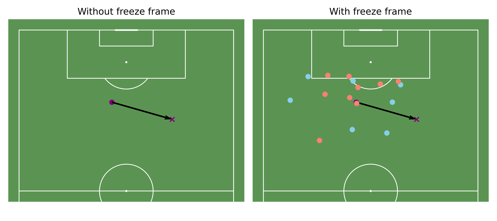

```{python}
#| echo: False
import pickle
from IPython.display import Markdown

with open("../../data/metadata/intro_event_example_id.pkl", "rb") as f:
    intro_event_example_id = pickle.load(f)

with open("../../data/metadata/intro_event_example_shot_id.pkl", "rb") as f:
    intro_event_example_shot_id = pickle.load(f)

with open("../../data/metadata/number_of_matches.pkl", "rb") as f:
    number_of_matches = pickle.load(f)

# with open("../../data/metadata/number_of_events.pkl", "rb") as f:
#     number_of_events = pickle.load(f)
```

# Introduction

The adoption of analytics in association football has grown significantly in the last couple of decades [@goesUnlockingPotentialBig2021; @olthofPerspectivesDataAnalytics2025; @schaerlaeckensBelgianLabShaping2025; @wakelamCollectionAnalysisExploitation2022], enabling football clubs to leverage insights to inform tactical decisions, coaching and recruitment. Much of this growth has involved development of metrics used to determine the value provided by a particular action made by a player. For example, expected goals (xG) provides the probability of a shot resulting in a goal, based on features about the shot event itself such as its location [@AssessingPerformancePremier]. Expected threat (xT) evaluates actions based on how they progress the ball towards areas of the pitch where goal scoring is more probable [@SinghIntroducingExpectedThreat2018]. A more sophisticated metric is Valuing Actions by Estimating Probabilities (VAEP) [@decroosActionsSpeakLouder2019]. 

VAEP considers the probability of scoring or conceding within the next $k$ events to assign a value between $-1$ and $1$ to each action. VAEP, like other such metrics, typically uses action-centric features such as the action's start and end location and type (carry, pass, shot) in estimating scoring/conceding probabilties, but this approach ignores spatial context [@desa-freireEventDataBased2025]. The spatial context - the position of teammates and opponents around the actor - of an action determines the options available to a player, showing viable passing options or space to carry into, as well as the proximity of opposition defenders applying pressure or blocking options. 

The StatsBomb Open Data repository [@StatsbombOpendata2026] provides events (e.g. carries, passes, shots) data for matches, along with *three-sixty* freeze frames which indicate the positions of players within proximity of the acting player. Such data can be used to incorporate spatial context as a predictive feature. @fig-intro-event-example compares a pass event from a match with and without the surrounding spatial context. Without the spatial context, this pass seems to be ineffective and raises a question over why it was not directed forwards towards the opponent's goal. Traditional VAEP would still take into account how passes of this trajectory may reduce the probability of conceding, but the addition of spatial context makes it clear that the left hand side of the actor is blocked by multiple opponents and this pass moves the ball into space on the right flank to open an attacking opportunity (in this case, a long-ranged shot)[^1]. 

[^1]: The pass event id is '`{python} intro_event_example_id`' and the subsequent long-ranged shot event id is '`{python} intro_event_example_shot_id`'

{#fig-intro-event-example}

## Research Objectives

As such, the aim of this proposed project is to determine to what extent the addition of spatial context features enhances the standard VAEP model. 

 - Develop embedding representations of spatial context from StatsBomb 360 freeze-frame data using deep learning techniques
 - Train and evaluate VAEP models, both with and without the inclusion of spatial context embeddings, using supervised classification algorithms.
 - Compare VAEP models using appropriate peformance metrics and  

# Previous Research


## Valuing Actions by Estimating Probabilities (VAEP)

$$
V(a_{i}) = \Delta P_{score} - \Delta P_{concede}
$$ {#eq-vaep}

Where $V(a_{i}) \in [-1,1]$

# Methodology

## Datasets

The proposed project will use data from StatsBomb's Open Data repository. This repository has "made certain leagues of StatsBomb Data freely available for public use for research projects and genuine interest in football analytics" [@StatsbombOpendata2026]. The StatsBomb Open Data repository provides the following datasets, and [data specification documents](https://github.com/statsbomb/open-data/tree/master/doc) exist which outline variables, data types and variable descriptions for each dataset: 

 - **competitions.json:** A single JSON file for competition summary information.
 - **events:** A directory containing a single JSON file for each match, detailing each event which takes place within that match (e.g. each pass, shot, carry etc.).
 - **lineups:** A directory containing a single JSON file for each match, providing information about each player who participated in that match (e.g. their position, shirt number, nationality).
 - **matches:** A directory containing a single JSON file for a season in a given competition, providing summary information about each match played in that season (e.g. match date, home/away teams and scores).
 - **three-sixty:** A directory containing a single JSON file for each match, providing data for each event in a given match detailing the position of each player in the broadcaster's frame at the moment of that event.

The proposed project will use data corresponding to `{python} number_of_matches` matches from UEFA Men's Euro 2020 & 2024, UEFA Women's Euro 2022 & 2025, FIFA Men's World Cup 2022, FIFA Women's World Cup 2023. Unlike most competitions in this repository, **three-sixty** data is available for every match in this sample, enabling player positional context to be incorporated into feature engineering for XXXXXX match events.

### Limitations of Datasets

Football analysts often makes use of tracking data [@goesUnlockingPotentialBig2021]. Rather than considering discrete time events, tracking data provides a continuous record of player and ball position for the duration of a match. This enables analysts to model actions in matches as continuous processes, accounting for the position and movements of the entire team, unlike with events data. Such tracking data is often proprietory and is thus not available for public use [@bassekIntegratedDatasetSpatiotemporal2025]. This limits the scope of the present project to viewing events as discrete in time, thus losing some surrounding context which may be informative. 

Events data is nonetheless relatively comprehensive, covering a much larger sample of matches than the limited publicly-available tracking data [@olthofPerspectivesDataAnalytics2025]. Furthermore, the use of StatsBomb's **three-sixty** data aims to address this limitation somewhat by providing snapshots of proximal player positions at the point of each event, allowing some inference to be made regarding team positioning during match events. However, these snapshots do not necessarily capture every player's location during an event, just those within the view of the broadcast camera [@StatsbombOpendata2026]. 

## VAEP Model Training


### Logistic Regression

$$
P(Y = 1 | X) = \frac{1}{1+e^{\displaystyle-(\beta_{0}+\beta_{1}x_{1}+\dots+\beta_{n}x_{n})}}
$$

#### Loss Function: Cross-Entropy Loss

$$
H(p,q)=-\sum_{x \in X}p(x)\log q(x)
$$

### Random Forest

#### Split Criterion: Gini Impurity

### XGBoost

### Catboost

## VAEP Model Evaluation Metrics

### Brier Score

$$
BS = \frac{1}{N}\sum_{j=1}^{r}\sum_{i=1}^{n}(f_{ij}-E_{ij})^{2}
$$

For binary classification

### AUC-ROC

### Cross-Entropy Loss

# Project Planning

 - A Gantt Chart

# Conclusion

